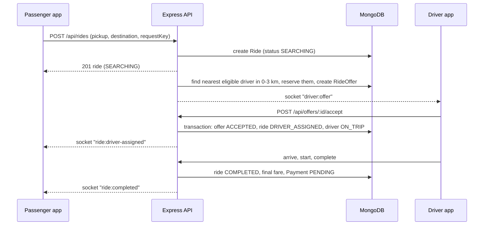

# 00 · Project overview

> Part of the project documentation. Next: [01 System architecture](01-system-architecture.md).

## What this application does

This is a ride-booking application, similar in spirit to Uber or Ola. A **passenger** chooses a pickup point and a destination on a map, sees an estimated fare in Indian rupees, and requests a ride. The server then looks for a **driver** nearby, one driver at a time, starting close to the pickup and searching farther away only if nobody nearby accepts. When a driver accepts, the passenger sees the driver's name, vehicle and live position on the map. The driver marks arrival, starts the trip and completes it. The server calculates the final fare and records a payment. An **admin** can approve drivers and inspect what happened to every ride.

The interesting part is not the screens but what happens behind them:

- Two passengers might want the same driver **at the same moment**. The system must never give one driver to two rides.
- A driver might accept an offer **at the same moment** the passenger cancels. The system must end up in one consistent state.
- The server might **crash** while waiting for a driver to answer. When it starts again, the waiting ride must continue, not get stuck forever.

Most of the code (and most of these documents) is about handling those situations correctly.

## The three roles

| Role | What they can do | Where in the code |
| --- | --- | --- |
| Passenger (`PASSENGER`) | Register, estimate fares, request one ride at a time, follow it live, cancel while allowed, pay, see history | `server/src/routes/index.js` (routes guarded by `requireRole(PASSENGER)`), `client/src/pages/PassengerHome.jsx`, `RidePage.jsx`, `HistoryPage.jsx` |
| Driver (`DRIVER`) | Register with a vehicle, wait for admin approval, go online/offline, send location, accept or decline offers, arrive/start/complete trips, see earnings | `server/src/services/driverService.js`, `offerService.js`, `client/src/pages/DriverHome.jsx`, `DriverTrips.jsx` |
| Admin (`ADMIN`) | Approve or reject drivers, view users, rides, offers, timelines and metrics | `server/src/services/adminService.js`, `client/src/pages/AdminPage.jsx` |

Admins cannot sign themselves up; an admin account is created with `npm run seed:admin` (see [12 Docker](12-docker-local-development.md)).

## Technologies and what each one is responsible for

| Technology | Responsibility here |
| --- | --- |
| **React + Vite** | The web app in `client/`. Vite is the development server and build tool. |
| **Tailwind CSS** | Styling through utility classes (`className="rounded-md px-4"`). Colours are defined in `client/tailwind.config.js`. |
| **React Router** | Maps URLs such as `/ride/:rideId` to pages (`client/src/App.jsx`). |
| **Axios** | Sends HTTP requests from the browser to the API (`client/src/services/api.js`). |
| **Leaflet / react-leaflet** | The map with OpenStreetMap tiles (`client/src/components/MapView.jsx`). |
| **Socket.IO** | Pushes real-time events (new offer, driver assigned, driver moved) from server to browser. |
| **Node.js + Express** | The API server in `server/`. |
| **MongoDB + Mongoose** | The database. Mongoose defines document shapes (schemas) and indexes. |
| **MongoDB replica set** | Required so that MongoDB supports multi-document **transactions**. |
| **JWT + bcrypt** | Login tokens and safe password storage (we use `bcryptjs`, a pure-JavaScript implementation of the same bcrypt algorithm, so no native compilation is needed in Docker). |
| **Zod** | Validates every request body, URL parameter and query string. |
| **Helmet, express-rate-limit, CORS** | Basic web security. |
| **pino** | Structured (JSON) logging with secrets redacted. |
| **Jest, Supertest, Vitest, React Testing Library** | Automated tests for the server and the web app. |
| **Docker Compose** | Runs MongoDB, the API, the recovery worker and the web app together. |

There is **no Redis, no Celery, no SQL database**. Everything that needs to be remembered (including timers and work queues) lives in MongoDB.

## The main ride-booking flow



In words:

1. The passenger requests a ride. The server computes the fare itself and stores a `Ride` with status `SEARCHING`.
2. The **matching service** looks for drivers within 3 km. The nearest eligible driver is **reserved** (so no other ride can take them) and receives an **offer** that expires after 15 seconds.
3. If that driver declines or does not answer, the next nearest driver gets an offer. If nobody in 0–3 km is left, the search moves to 3–6 km, then 6–9 km, then 9–12 km.
4. When a driver accepts, the ride becomes `DRIVER_ASSIGNED`. If nobody within 12 km accepts, the ride becomes `NO_DRIVER_FOUND`.
5. The driver arrives, starts and completes the trip. Completion records the final fare and a `PENDING` payment.

Details: [04 Ride booking](04-ride-booking-and-api-flow.md), [05 Progressive radius](05-progressive-radius-search.md), [06 Matching](06-driver-matching-algorithm.md).

## Folder structure

```text
uber clone/
├── docker-compose.yml        # mongo, backend, worker, frontend
├── .env.example              # configuration template (placeholders only)
├── mongo/init-replica-set.js # creates the replica set on first start
├── docs/                     # these documents
├── server/
│   ├── src/
│   │   ├── config/           # index.js (validated env config), db.js
│   │   ├── models/           # Mongoose schemas: User, DriverProfile, ...
│   │   ├── routes/index.js   # every URL and its middleware
│   │   ├── controllers/      # thin HTTP handlers
│   │   ├── services/         # business logic (matching, offers, rides, fares...)
│   │   ├── middleware/       # auth, validation, rate limits, error handler
│   │   ├── sockets/          # Socket.IO server + notifier
│   │   ├── workers/          # recovery worker (+ its own process entry)
│   │   ├── utils/            # transactions, geo maths, errors, logger, schemas
│   │   ├── app.js            # builds the Express app
│   │   └── server.js         # starts HTTP + Socket.IO
│   ├── scripts/              # seedAdmin.js, simulateDrivers.js
│   └── tests/                # unit/, integration/, e2e/, helpers/
└── client/
    └── src/
        ├── components/       # MapView, RideStatus, BookingForm, ...
        ├── pages/            # one file per screen
        ├── services/         # api.js (Axios), socket.js
        ├── hooks/            # useRideTracking, useLocationReporter
        ├── context/          # AuthContext
        ├── utils/format.js   # money, distance, coordinate validation
        └── __tests__/        # Vitest + React Testing Library
```

## Implementation status

**Implemented and covered by automated tests that were run and passed**

- Registration/login for passengers and drivers, JWT authentication, role checks, object-level ownership checks.
- Driver profile with vehicle, admin approval, online/offline, location updates with freshness checks.
- Server-side fare estimation and final fare (integer paise).
- Idempotent ride creation (`requestKey`), one active ride per passenger.
- Progressive-radius (3/6/9/12 km), ring-based, nearest-first, sequential matching with atomic reservations.
- Offer accept / reject / timeout, including repeated and late requests.
- Ride lifecycle (arrive, start, complete, cancel) with a validated state machine and a `RideEvent` audit trail.
- Concurrency protections (atomic conditional updates, transactions, unique indexes, per-ride lease).
- Database-backed recovery worker (expired offers, stalled rides, abandoned reservations).
- Socket.IO with authenticated connections and server-authorised ride rooms; cross-process delivery through MongoDB.
- Payments with a **mock** provider: online (signed webhook) and cash.
- React passenger, driver and admin interfaces with maps and live tracking.
- Docker Compose environment with a single-node replica set.

Test results: see [15 Testing guide](15-testing-guide.md) and the per-feature [implementation test log](implementation-test-log.md).

**Not implemented / limitations (be aware)**

- **No real payment gateway.** The mock provider pretends the charge succeeded. No card data is ever collected.
- **Distance is straight-line by default.** An OSRM road-routing integration exists (`ROUTING_PROVIDER=osrm`) but was not tested against a live OSRM server.
- **Address search** uses OpenStreetMap's public Nominatim service directly from the browser; it is rate-limited and meant for light development use.
- No refresh tokens, password reset, e-mail verification, surge pricing, or driver cancellation endpoint.
- **External services are not connected:** real SMS (Twilio), Google sign-in, emergency-response dispatch and payment refunds need credentials/agreements that this project does not have. Each is implemented behind an adapter with an honest development mode; see the feature documents below.
- A single-node replica set gives transactions but **not** high availability.
- Security has **not** been professionally reviewed; see [13 Security](13-security.md).

## Glossary

- **API**: the set of URLs the server answers (for example `POST /api/rides`).
- **Backend / frontend**: the server program (`server/`) and the browser program (`client/`).
- **Document / collection**: MongoDB stores JSON-like *documents*, grouped into *collections* (similar to rows and tables).
- **Offer**: a time-limited invitation for one driver to take one ride.
- **Reservation**: marking a driver as held for a ride so nobody else can offer them work.
- **Ring**: a band of distance around the pickup, such as "more than 3 km and up to 6 km".
- **Socket / real-time event**: a message the server pushes to the browser without the browser asking.
- **Transaction**: several database changes that succeed or fail together.
- **Idempotent**: doing the same request twice has the same effect as doing it once.

## Upgrade: features added after the first version

The second phase added the features below (audit of the starting point: [implementation-audit.md](implementation-audit.md); test results per step: [implementation-test-log.md](implementation-test-log.md)).

| Feature | Document | Status |
| --- | --- | --- |
| Trip-start and trip-completion codes, destination hidden until pickup | [16](16-otp-and-trip-verification.md) | implemented and tested |
| Two-way reviews and ratings with moderation | [17](17-reviews-and-ratings.md) | implemented and tested |
| Bike / Auto / Car / Car XL, configurable fares, passenger capacity | [18](18-vehicle-types-and-capacity.md) | implemented and tested |
| Safety button, incidents, emergency-integration adapter | [19](19-safety-and-emergency-response.md) | implemented and tested; **no real emergency service connected** |
| Women-driver preference (verified drivers only) | [20](20-women-safety-and-matching-preferences.md) | implemented and tested |
| Passenger–driver chat | [22](22-chat-system.md) | implemented and tested |
| Driver documents and admin review | [23](23-driver-document-verification.md) | implemented and tested; **no government/KYC verification** |
| Phone OTP and Google sign-in, explicit account linking | [24](24-authentication-providers.md) | implemented and tested with local adapters; **live Twilio/Google not exercised** |
| Admin permissions, audit log, user/ride/payment management | [25](25-admin-management-and-audit.md) | implemented and tested; refunds are requests only |

New folders: `server/src/migrations/` (safe data migrations run at startup), new services (`rideOtpService`, `reviewService`, `chatService`, `safetyService`, `emergencyService`, `driverOnboardingService`, `documentStorage`, `auditService`, `smsService`, `googleIdentity`, `driverEligibility`), `client/src/pages/admin/`. There is no document 21; the numbering follows the upgrade request.
