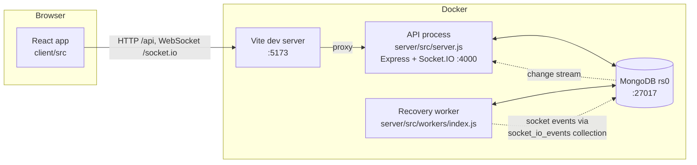
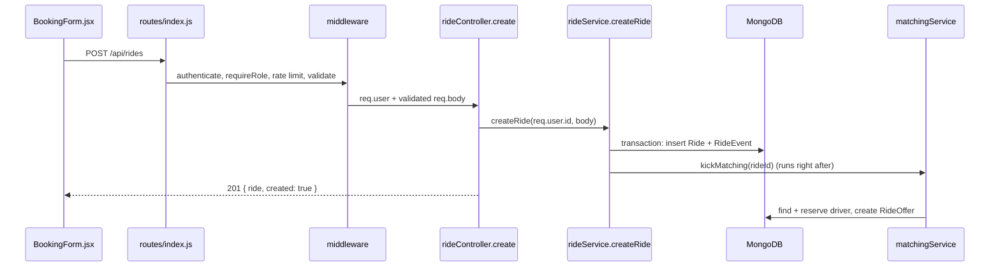

# 01 · System architecture

> Previous: [00 Overview](00-project-overview.md) · Next: [02 Database design](02-database-design-and-relationships.md)

## The basic idea

A web application is usually split into parts that each do one job:

- The **frontend** is the program running in your browser. It draws screens and reacts to clicks. Here it is a React app in `client/`.
- The **backend** is a program running on a server. It decides what is allowed, does calculations, and stores data. Here it is an Express app in `server/`.
- The **database** remembers everything permanently. Here it is MongoDB.
- **Real-time communication** lets the server tell the browser "something changed" immediately, instead of the browser asking over and over. Here it is Socket.IO.

Analogy: a restaurant. The frontend is the waiter talking to you, the backend is the kitchen deciding what can be cooked and cooking it, the database is the pantry and the order book, and real-time communication is the kitchen bell that rings when your dish is ready.

Why split it? The browser cannot be trusted (anyone can change JavaScript in their own browser), so **every decision that matters (prices, who gets which driver, who may cancel) is made in the backend**.

## The pieces in this project



1. The browser loads the React app from the **Vite dev server** on port 5173.
2. The React app sends HTTP requests to `/api/...` and opens a WebSocket at `/socket.io`. Both go to Vite, which **proxies** (forwards) them to the API container (`client/vite.config.js`). The browser therefore only ever talks to one address, which avoids CORS problems in development.
3. The **API process** (`server/src/server.js`) runs Express for HTTP and Socket.IO for real-time events, and talks to MongoDB through Mongoose.
4. The **recovery worker** (`server/src/workers/index.js`) is a second Node.js process using the same code and database. It has no HTTP server. It cleans up after timeouts and crashes ([08](08-offer-acceptance-rejection-and-timeouts.md), [14](14-error-handling-and-recovery.md)).
5. When the worker needs to notify a browser, it writes the event into the MongoDB collection `socket_io_events`. Each API process watches that collection (using the Socket.IO **MongoDB adapter**) and forwards the event to the right browser. This is how we get cross-process messaging **without Redis**.

## How React talks to Express

`client/src/services/api.js` creates one Axios instance:

```js
export const api = axios.create({ baseURL: '/api', timeout: 15000 });
api.interceptors.request.use((config) => {
  if (token) config.headers.Authorization = `Bearer ${token}`;
  return config;
});
```

- `baseURL: '/api'` means `rideApi.create(body)` becomes `POST /api/rides`.
- The *interceptor* adds the login token to every request automatically.
- The server always answers in one shape: `{ "success": true, "data": ... }` or `{ "success": false, "error": { "code", "message", "details?" } }`. `errorMessage(err)` turns the error shape into a readable sentence for the screen.

## How Express talks to MongoDB

Mongoose **models** (in `server/src/models/`) describe each collection. Services call model methods such as `Ride.findOneAndUpdate(...)`. The connection is opened once in `server/src/config/db.js` (`connectDb`) using `MONGO_URI`.

## Layers inside the backend, and why business logic lives in services

A request passes through layers. Each layer has one job:

| Layer | Folder | Job | Example |
| --- | --- | --- | --- |
| Routes | `routes/index.js` | Connect a URL + method to middleware and a controller | `api.post('/rides', authenticate, requireRole(PASSENGER), limiters.booking, validate({ body: schemas.createRide }), h(rides.create))` |
| Middleware | `middleware/` | Cross-cutting checks run before the handler | `authenticate` (who are you?), `requireRole` (are you allowed?), `validate` (is the input well-formed?) |
| Controllers | `controllers/` | Translate HTTP into a service call and back | `rideController.create` calls `rideService.createRide(req.user.id, req.body)` |
| Services | `services/` | **Business rules** | `matchingService.advanceMatching`, `offerService.acceptOffer`, `fareService.calculateFare` |
| Models | `models/` | Shape, validation and indexes of stored data | `Ride`, `RideOffer` |
| Workers | `workers/` | Background jobs not triggered by a user | `RecoveryWorker.runOnce` |
| Sockets | `sockets/` | Real-time connections and sending events | `createSocketServer`, `notifier.rideStatus` |

Why keep business logic in services and not in controllers?

- **Reuse.** Offer expiry is triggered by a timer, by the recovery worker, and by matching itself. All three call the same `offerService.expireOffer`. If that logic lived in a controller, the worker could not use it.
- **Testing.** Tests call services directly (`matching.advanceMatching(ride._id)`) without HTTP.
- **Readability.** Controllers stay a few lines long; the rules are in one place.

## How a ride request travels through the system



1. `BookingForm.jsx` calls `rideApi.create(...)`.
2. `authenticate` (in `middleware/auth.js`) verifies the JWT and loads the user from MongoDB.
3. `requireRole(PASSENGER)` rejects drivers and admins with `403`.
4. `limiters.booking` rejects floods of requests with `429`.
5. `validate({ body: schemas.createRide })` rejects malformed input with `400`, including unknown fields like `fare` or `driverId`.
6. `rideController.create` calls `rideService.createRide`.
7. The service computes the fare, creates the `Ride` and a `RIDE_REQUESTED` event in one transaction, then triggers matching with `kickMatching`.
8. The controller returns `201` with the ride (status `SEARCHING`).
9. Matching continues in the background and notifies the driver by socket.

## What can go wrong here

| Problem | What you see | How to debug |
| --- | --- | --- |
| Browser cannot reach API | "Cannot reach the server" on screen | `docker compose ps`, `docker compose logs -f backend`, open `http://localhost:4000/api/health` |
| API cannot reach MongoDB | API container restarts; health returns `503` | `docker compose logs mongo`, check `MONGO_URI` uses host `mongo`, see [12](12-docker-local-development.md) |
| Worker events not reaching browsers | Driver never sees offer created by the worker | Check `SOCKET_ADAPTER=mongo` and that collection `socket_io_events` exists |

## Glossary

- **Proxy**: a middleman that forwards requests to another address.
- **Middleware**: a function that runs before the main handler and can stop the request.
- **Controller**: a small function that handles one HTTP route.
- **Service**: a module containing business rules.
- **Model / schema**: the definition of what a stored document looks like.
- **Adapter (Socket.IO)**: a plug-in that lets several server processes share socket events.
- **Change stream**: a MongoDB feature that lets a program watch a collection for new changes; needs a replica set.

## Upgrade: what was added to the architecture

- **New services** keep the same layering (routes → middleware → controllers → services → models): see [00](00-project-overview.md#upgrade-features-added-after-the-first-version).
- **One eligibility rule** (`services/driverEligibility.js`) is shared by matching, reservation and acceptance.
- **Adapters for outside services:** `smsService` (dev outbox / Twilio / disabled), `googleIdentity` (Google keys), `emergencyService` (none / webhook), `documentStorage` (encrypted local disk). Each has an honest development mode and never fakes success.
- **The recovery worker** now also retries emergency dispatches and purges expired driver documents and old chat messages ([14](14-error-handling-and-recovery.md)).
- **Socket.IO:** admins join the room `role:ADMIN` (safety alerts); chat uses `chat:send` / `chat:history` with database authorisation on every message ([22](22-chat-system.md)).
- **Startup:** `server.js`, `workers/index.js` and the scripts run `runMigrations()` before `ensureIndexes()`.
