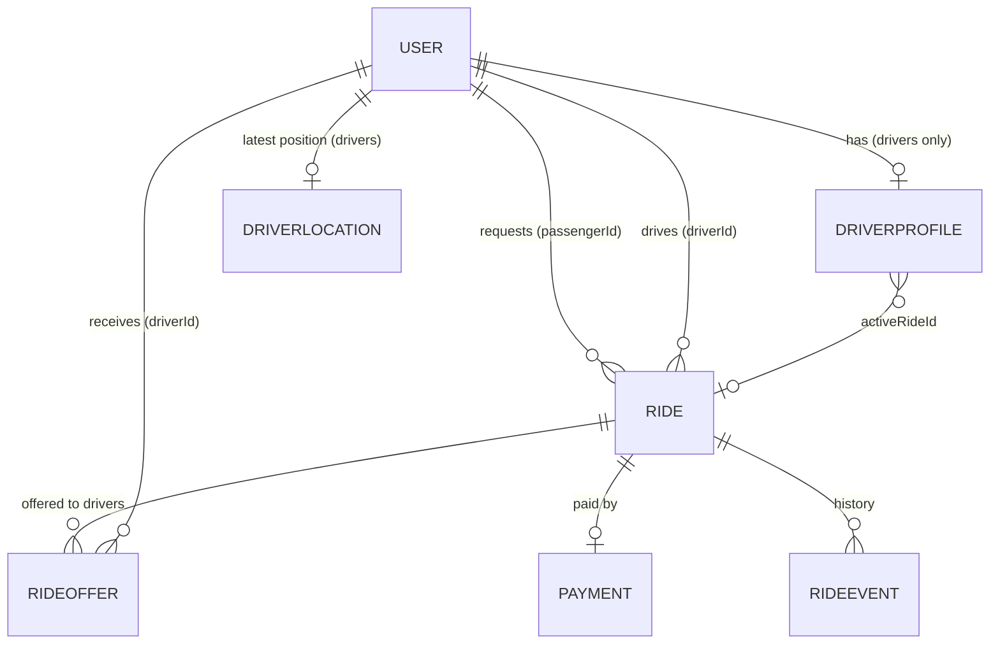

# 02 · Database design and relationships

> Previous: [01 Architecture](01-system-architecture.md) · Next: [03 Auth](03-authentication-and-authorization.md)

## The basic idea

MongoDB stores **documents** (JSON-like objects) inside **collections**. Unlike a spreadsheet, two documents in the same collection may have slightly different shapes, so we use **Mongoose schemas** to enforce a shape, defaults and validation. An **index** is a lookup structure (like the index at the back of a book) that makes queries fast and can also *enforce uniqueness*.

Important: in MongoDB, a field such as `ride.driverId` that holds another document's `_id` is just a value. MongoDB does **not** check that the referenced document exists and does **not** stop you deleting it. Mongoose's `ref: 'User'` only helps with `.populate()` (loading the referenced document). Our code therefore checks relationships itself.

## Relationship diagram



All "driver" references (`Ride.driverId`, `RideOffer.driverId`, `DriverLocation.driverId`, `DriverProfile.userId`) hold the **driver's User `_id`**.

## Collections

Model files live in `server/src/models/`. Mongoose turns model names into lower-case plural collection names.

### User → collection `users` (`User.js`)

Purpose: every account (passenger, driver, admin).

| Field | Type | Required | Default / rules |
| --- | --- | --- | --- |
| `name` | String | yes | trimmed, 1–100 chars |
| `email` | String | yes | trimmed + lower-cased, max 254 |
| `phone` | String | no | max 20 |
| `passwordHash` | String | yes | bcrypt hash; `select: false` so queries never return it unless asked |
| `role` | String | yes | `PASSENGER` (default), `DRIVER`, `ADMIN` |
| `createdAt`, `updatedAt` | Date | auto | `timestamps: true` |

Indexes: `{ email: 1 }` **unique** (so two accounts cannot share an email, even with different capitalisation, because emails are lower-cased first); `{ phone: 1 }` unique **partial** (only applies to documents that have a phone, so many users can leave it empty).

`toJSON` removes `passwordHash` and `__v` and renames `_id` to `id`.

### DriverProfile → `driverprofiles` (`DriverProfile.js`)

Purpose: driver-only information and the driver's **current work state**.

| Field | Type | Required | Default / rules |
| --- | --- | --- | --- |
| `userId` | ObjectId → User | yes | |
| `vehicle.type` | String | yes | `BIKE`, `AUTO`, `CAR` |
| `vehicle.registrationNumber` | String | yes | upper-cased; validators strip spaces/dashes |
| `vehicle.model`, `vehicle.color` | String | no | |
| `approvalStatus` | String | yes | `DOCUMENTS_REQUIRED` (default), `PENDING_REVIEW`, `APPROVED`, `REJECTED`, `SUSPENDED` (see [23](23-driver-document-verification.md)) |
| `availability` | String | yes | `OFFLINE` (default), `AVAILABLE`, `RESERVED`, `ON_TRIP` |
| `activeRideId` | ObjectId → Ride | no | `null` when free |
| `reservedAt` | Date | no | when the current reservation began |

Indexes: `{ userId: 1 }` unique (one profile per user), `{ 'vehicle.registrationNumber': 1 }` unique, `{ availability: 1, approvalStatus: 1 }`, `{ activeRideId: 1 }`.

`availability` + `activeRideId` are the heart of the **double-booking protection**: a driver is offered work only when they are `AVAILABLE` with `activeRideId: null`, and both fields are changed together in one atomic update ([07](07-concurrency-consistency-and-atomic-operations.md)).

### DriverLocation → `driverlocations` (`DriverLocation.js`)

Purpose: the latest known position of each driver (one document per driver, overwritten on every update).

| Field | Type | Notes |
| --- | --- | --- |
| `driverId` | ObjectId → User | required |
| `location` | GeoJSON Point | `{ type: 'Point', coordinates: [longitude, latitude] }`; validated by `isValidLatLng` |
| `heading` | Number | optional, 0–360 |
| `updatedAt` | Date | set by the server when an update is accepted |

Indexes: `{ driverId: 1 }` unique (so concurrent updates cannot create duplicates), `{ location: '2dsphere' }` (a **geospatial index**, required for "find nearest" queries).

Why a separate collection instead of a field on DriverProfile? Locations change every few seconds while profiles rarely change. Keeping them apart keeps the geospatial index small and avoids rewriting the profile constantly.

### Ride → `rides` (`Ride.js`)

Purpose: one trip request from creation to its final state.

| Field | Type | Notes |
| --- | --- | --- |
| `passengerId` | ObjectId → User | required |
| `driverId` | ObjectId → User | `null` until a driver accepts |
| `pickup`, `destination` | embedded `{ address, location: GeoJSON Point }` | required |
| `vehicleType` | String | `BIKE`/`AUTO`/`CAR`, default `CAR` |
| `paymentMethod` | String | `CASH` (default) / `ONLINE` |
| `status` | String | see [09](09-ride-lifecycle.md); default `SEARCHING` |
| `active` | Boolean | `true` until a terminal status |
| `estimatedFare`, `finalFare` | Number (integer paise) | final is `null` until completion |
| `currency` | String | `INR` |
| `estimate` | embedded | `distanceMeters`, `durationSeconds`, `source` (`straight_line`/`osrm`), `breakdown` |
| `finalBreakdown` | embedded | how the final fare was computed |
| `tripDistanceMeters` | Number | added up from driver location updates during `IN_PROGRESS` |
| `requestKey` | String | client-generated idempotency key, 8–100 chars |
| `matchingRadiusKm` | Number | outer edge of the ring currently/last searched |
| `matchingStartedAt` | Date | |
| `matching` | embedded | **matching progress**, see below |
| `assignedAt`, `arrivedAt`, `startedAt`, `completedAt`, `cancelledAt` | Date | |
| `cancelledBy`, `cancelReason` | | |

`matching` sub-document:

| Field | Meaning |
| --- | --- |
| `ringIndex` | which ring is being searched (0 = 0–3 km) |
| `attemptedDriverIds` | every driver already tried; never offered this ride again |
| `currentOfferId` | the open offer, if any |
| `lockOwner`, `lockedUntil` | the **lease**: which process may run matching for this ride, and until when |
| `kicks` | counter used to ask the lease holder to run again |
| `lastProgressAt` | used by the recovery worker to spot stuck rides |

Indexes:

- `{ passengerId: 1, requestKey: 1 }` **unique** → a retried booking cannot create a second ride.
- `{ passengerId: 1 }` **unique, partial `{ active: true }`** (named `one_active_ride_per_passenger`) → a passenger can have only one active ride, even if two different requests race.
- `{ passengerId: 1, createdAt: -1 }` (history), `{ driverId: 1, status: 1, createdAt: -1 }`, `{ status: 1, 'matching.lockedUntil': 1 }` (worker scans).

Why are pickup/destination **embedded**? They belong to exactly one ride and are always read with it. Embedding means one read instead of two.

### RideOffer → `rideoffers` (`RideOffer.js`)

Purpose: one invitation to one driver for one ride.

| Field | Notes |
| --- | --- |
| `rideId`, `driverId` | required references |
| `status` | `PENDING` (default), `ACCEPTED`, `REJECTED`, `EXPIRED`, `CANCELLED` |
| `ringIndex`, `distanceMeters` | where the driver was found |
| `offeredAt`, `expiresAt`, `respondedAt` | `expiresAt = offeredAt + OFFER_TIMEOUT_MS` |

Indexes: `{ rideId: 1, driverId: 1 }` unique (a driver gets at most one offer per ride); `{ rideId: 1 }` unique **partial** `{ status: 'PENDING' }` (named `one_pending_offer_per_ride`, so a ride never has two open offers); `{ status: 1, expiresAt: 1 }` (worker finds expired offers fast); `{ driverId: 1, status: 1 }`.

Why separate from Ride? A ride may produce many offers; storing them separately keeps the ride document small and makes "pending offers for this driver" a simple indexed query.

### Payment → `payments` (`Payment.js`)

| Field | Notes |
| --- | --- |
| `rideId`, `passengerId` | required |
| `amount` | integer paise |
| `currency` | `INR` |
| `method` | `CASH` / `ONLINE` |
| `status` | `PENDING`, `PROCESSING`, `SUCCEEDED`, `FAILED`, `REFUNDED` |
| `providerReference` | opaque id from the (mock) provider |
| `failureReason`, `settledAt` | |

Indexes: `{ rideId: 1 }` unique (one payment per ride), `{ providerReference: 1 }` unique partial. **No card data is stored**.

### RideEvent → `rideevents` (`RideEvent.js`)

Purpose: an append-only audit trail ("what happened, when, who did it").

| Field | Notes |
| --- | --- |
| `rideId` | required |
| `actorId` | user who caused it, or `null` for the system |
| `eventType` | `RIDE_REQUESTED`, `OFFER_SENT`, `OFFER_REJECTED`, `OFFER_EXPIRED`, `RADIUS_EXPANDED`, `DRIVER_ASSIGNED`, `DRIVER_ARRIVED`, `TRIP_STARTED`, `TRIP_COMPLETED`, `RIDE_CANCELLED`, `NO_DRIVER_FOUND`, `PAYMENT_UPDATED` |
| `previousStatus`, `newStatus` | ride status before/after |
| `metadata` | free-form details (offer id, ring, fare...) |
| `createdAt` | automatic |

Index: `{ rideId: 1, createdAt: 1 }`.

### `socket_io_events` (not a Mongoose model)

A capped collection used only by the Socket.IO MongoDB adapter for cross-process events ([11](11-realtime-communication-and-tracking.md)).

## How indexes are created

`ensureIndexes()` in `server/src/models/index.js` creates each collection and calls `syncIndexes()`. It runs when the API, the worker, or the tests start. Index existence and uniqueness are verified by `server/tests/integration/health-and-indexes.test.js`.

## Tracing one ride through the collections

Example: Asha books a car from MG Road to Koramangala. Driver Ravi (1 km away) declines; driver Meena (4.5 km away) accepts.

1. **Booking.** `rides` gets `{ status: 'SEARCHING', active: true, driverId: null, estimatedFare: 13100, matching: { ringIndex: 0, attemptedDriverIds: [] } }`. `rideevents` gets `RIDE_REQUESTED`.
2. **Offer to Ravi.** In one transaction: Ravi's `driverprofiles` doc becomes `{ availability: 'RESERVED', activeRideId: <ride> }`; `rideoffers` gets `{ driverId: Ravi, status: 'PENDING', ringIndex: 0, expiresAt: now+15s }`; the ride's `attemptedDriverIds` becomes `[Ravi]`; event `OFFER_SENT`.
3. **Ravi declines.** Offer → `REJECTED`; Ravi → `AVAILABLE, activeRideId: null`; event `OFFER_REJECTED`.
4. **Ring 0 empty.** Ride `matching.ringIndex: 1`, `matchingRadiusKm: 6`; event `RADIUS_EXPANDED`.
5. **Offer to Meena** (as in step 2, `ringIndex: 1`).
6. **Meena accepts.** In one transaction: offer → `ACCEPTED`; ride → `{ status: 'DRIVER_ASSIGNED', driverId: Meena }`; Meena → `ON_TRIP`; event `DRIVER_ASSIGNED`.
7. **Trip.** Events `DRIVER_ARRIVED`, `TRIP_STARTED`; `driverlocations` updates add to `tripDistanceMeters`.
8. **Completion.** Ride → `{ status: 'COMPLETED', active: false, finalFare }`; Meena → `AVAILABLE`; `payments` gets `{ status: 'PENDING', amount: finalFare }`; event `TRIP_COMPLETED`.

Sample ride document (trimmed):

```json
{
  "_id": "6ad6661ebe739f2c685f0d50",
  "passengerId": "6ad6661cbe739f2c685f0d48",
  "driverId": "6ad665b1be739f2c685f0b24",
  "pickup": { "address": "MG Road", "location": { "type": "Point", "coordinates": [77.59455, 12.97161] } },
  "status": "DRIVER_ASSIGNED",
  "active": true,
  "estimatedFare": 19400,
  "currency": "INR",
  "requestKey": "0d6e0e0a-3c1e-4a0c-9d1e-0c9b6d1a2f11",
  "matchingRadiusKm": 6,
  "matching": { "ringIndex": 1, "attemptedDriverIds": ["...Ravi", "...Meena"], "currentOfferId": null, "lockOwner": null }
}
```

## What can go wrong

- **Duplicate key error (code 11000).** A unique index refused a write. The code catches these deliberately (for example in `rideService.createRide`). Unexpected ones become `409 DUPLICATE` in `errorHandler.js`.
- **Coordinates in the wrong order.** `[lat, lng]` instead of `[lng, lat]` puts Bengaluru in the Indian Ocean or fails validation. Always use `toPoint()` / `fromPoint()` in `utils/geo.js`.
- **Dangling references.** Because MongoDB doesn't enforce references, a profile could point at a ride that no longer needs it. The recovery worker's `reconcileDrivers` fixes such drivers.

Inspect data: `docker compose exec mongo mongosh uber` then `db.rides.find().sort({createdAt:-1}).limit(1).pretty()`.

## Glossary

- **ObjectId**: MongoDB's 12-byte unique id (shown as 24 hex characters).
- **Index / unique index / partial index**: a lookup structure; *unique* forbids duplicates; *partial* applies only to documents matching a filter.
- **GeoJSON**: a standard JSON format for geographic shapes; a point is `{ type: 'Point', coordinates: [lng, lat] }`.
- **Geospatial (2dsphere) index**: an index that understands positions on a sphere (the Earth).
- **Embedded document**: an object stored inside another document.
- **Reference**: a field holding another document's `_id`.

## Upgrade: new collections and fields

| Collection | Purpose | Key indexes | Document |
| --- | --- | --- | --- |
| `rideotps` | trip codes (hash + ciphertext, attempts, expiry) | one ACTIVE per ride+purpose | [16](16-otp-and-trip-verification.md) |
| `authotps` | phone-login challenges | one ACTIVE per phone; TTL | [24](24-authentication-providers.md) |
| `reviews` | ratings and comments | unique `{rideId, reviewerId, revieweeId}` | [17](17-reviews-and-ratings.md) |
| `chatmessages`, `chatreports` | chat and reports | unique `{rideId, senderId, clientMessageId}` | [22](22-chat-system.md) |
| `safetyincidents` | safety alerts and dispatch status | one open per ride+reporter | [19](19-safety-and-emergency-response.md) |
| `driverdocuments` | uploaded document metadata (file is in private storage) | one current per driver+type | [23](23-driver-document-verification.md) |
| `auditlogs` | admin actions | by time, actor, target | [25](25-admin-management-and-audit.md) |
| `devoutboxmessages` | development-only SMS copies, auto-deleted after 1 h | TTL | [24](24-authentication-providers.md) |
| `migrations` | which data migrations ran | `_id` = migration id | below |

New fields: `users.accountStatus`, `suspension`, `phoneVerifiedAt`, `authProviders[]`, `adminPermissions`, `ratingStats`, and `passwordHash` became optional; `driverprofiles.vehicle.capacity`, `identity`, `review`, `femaleDriverProgram`, `serviceRatingStats`; `rides.passengerCount`, `driverPreference`, `noDriverReason`, `startVerifiedAt`, `completionVerifiedAt`; `payments.refund`.

### Migrations

`server/src/migrations/index.js` upgrades existing data safely: each migration only touches documents still in the old shape, is recorded in `migrations`, and is claimed atomically so two processes never run it twice. They run before index creation. Applied: `001` driver profiles (old `PENDING` → `DOCUMENTS_REQUIRED`, capacity defaults; approved drivers stay approved), `002` rides, `003` users (existing admins get `*`), `004` phone normalisation. Nothing is deleted. Tested in `tests/integration/migrations.test.js`.
