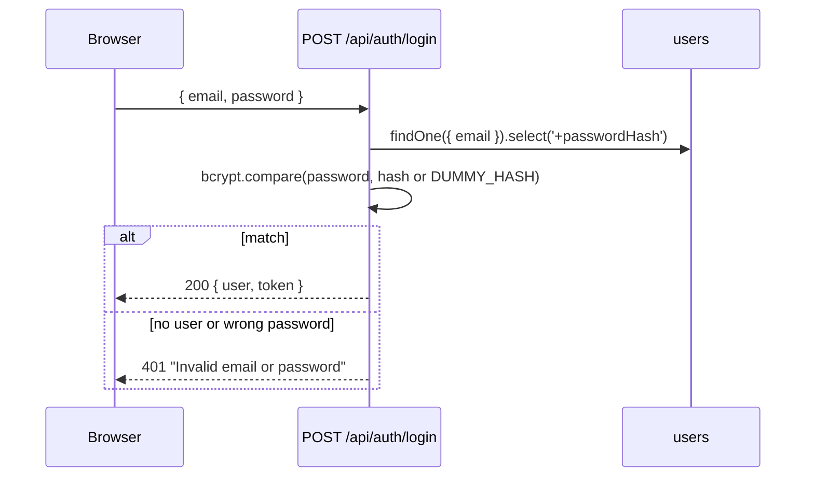
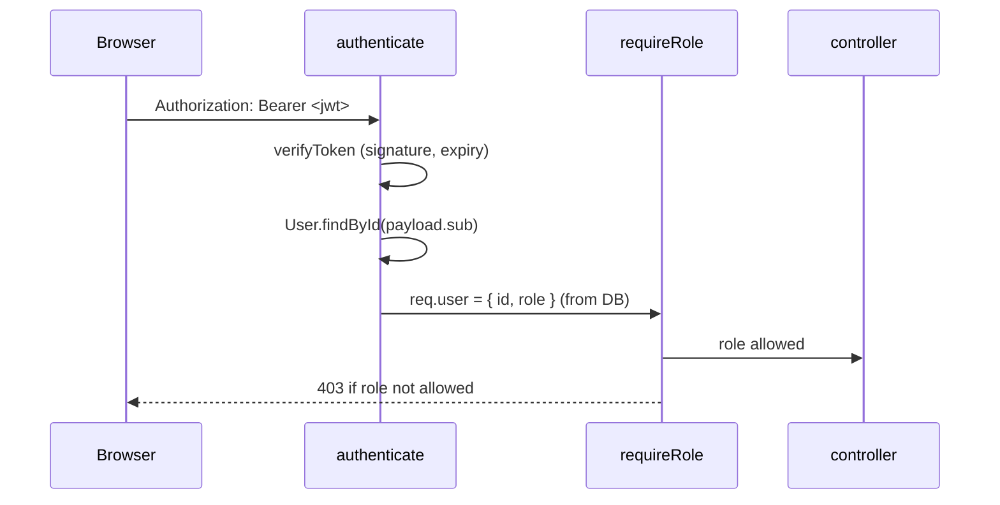

# 03 · Authentication and authorization

> Previous: [02 Database](02-database-design-and-relationships.md) · Next: [04 Booking flow](04-ride-booking-and-api-flow.md)

## The basic idea

- **Authentication** answers "**who are you?**" (logging in).
- **Authorization** answers "**what are you allowed to do?**" (a passenger may not accept driver offers).

Analogy: at an office, your ID card at the entrance is authentication; whether the card opens the server room is authorization.

Without these, anyone could cancel anyone's ride or pretend to be a driver.

## Registration

`POST /api/auth/register` → `validate({ body: schemas.register })` → `authController.register` → `authService.register`.

1. `schemas.register` (in `server/src/utils/validators.js`) checks: name, a valid email (lower-cased), a password of 8–72 characters containing a letter and a digit, optional phone, `role` of `PASSENGER` or `DRIVER` only (**admins cannot self-register**), and a `vehicle` if and only if the role is `DRIVER`. Unknown fields are rejected.
2. The password is hashed: `bcrypt.hash(password, config.auth.bcryptRounds)`.
3. For drivers, the `User` and `DriverProfile` are created **in one transaction**, so we never get a driver user without a profile.
4. A duplicate email or registration number makes MongoDB's unique index fail; this becomes `409 DUPLICATE`.
5. The response contains the user (without the hash) and a JWT.

## Password hashing with bcrypt

We never store passwords. We store a **hash**, the output of a one-way function. At login we hash what the user typed and compare. bcrypt is deliberately slow and adds a random **salt**, so attackers who steal the database cannot quickly guess passwords and identical passwords produce different hashes. The `passwordHash` field has `select: false`, so ordinary queries never load it. Passwords are limited to 72 characters because bcrypt ignores anything after 72 bytes.

## Login



`authService.login` compares against a `DUMMY_HASH` when the email doesn't exist. That makes "unknown email" and "wrong password" take the same time and return the same message, so attackers can't discover which emails have accounts.

## JWT access tokens

A **JWT** (JSON Web Token) is a signed string like `xxxxx.yyyyy.zzzzz`. The middle part holds claims (`{ sub: userId, role, exp }`); the last part is a **signature** made with `JWT_SECRET`. Anyone can *read* a JWT, but nobody can *change* it without the secret: changing `role` breaks the signature.

- Created by `signToken(user)` with `HS256` and `JWT_EXPIRES_IN` (default `1h`).
- Checked by `verifyToken(token)`, which accepts only `HS256` and rejects expired or tampered tokens with `401`.

## Protected routes



`server/src/middleware/auth.js`:

```js
const payload = verifyToken(token);               // 401 if bad/expired
const user = await User.findById(payload.sub).lean();
if (!user) throw unauthorized('User no longer exists');
req.user = { id: String(user._id), role: user.role, name: user.name, email: user.email };
```

The role is read **from the database**, not from the token. So if an admin changes someone's role, or someone forges a token claim, the database wins (tested in `auth.test.js`: "role comes from the database").

## Permissions by role

| Action | Passenger | Driver | Admin |
| --- | --- | --- | --- |
| Estimate / request ride, history, pay | ✅ | ❌ | ❌ |
| View a ride | own rides | rides assigned to them | all |
| Cancel a ride | own ride (SEARCHING / DRIVER_ASSIGNED / DRIVER_ARRIVED) | ❌ | via `POST /api/admin/rides/:id/cancel` with `rides:manage`, reason required, audited |
| Availability, location, offers, accept/reject | ❌ | ✅ (own) | ❌ |
| Arrive / start / complete, cash collected | ❌ | only the **assigned** driver | ❌ |
| Admin endpoints | ❌ | ❌ | ✅ |

## Object-level ownership checks

Role checks are not enough: a passenger is allowed to view rides, but only **their own**. These checks live in services:

- `rideService.getRideForUser` returns `404` (not `403`) when you are not the passenger, the assigned driver or an admin, so strangers cannot even confirm a ride exists.
- `offerService.loadOwnOffer` returns `403` when the offer belongs to another driver.
- `rideService.driverTransition` returns `403` unless `ride.driverId` is you.
- `paymentService.loadOwnedRidePayment` returns `404` for someone else's ride.
- Socket `ride:subscribe` checks the same ownership before joining a ride room.

## Why the server must not trust IDs or roles from the frontend

Anything the browser sends can be edited by its user. So:

- `passengerId` comes from `req.user.id`, never from the body. Sending `passengerId` in the body is **rejected** by the strict Zod schema (`booking.test.js` #18).
- Fares, statuses, and driver IDs are never accepted from the client.
- The UI decides what to *show* using `/auth/me`, but the server enforces everything again.

## Token handling in the browser

`client/src/context/AuthContext.jsx` keeps the token in `sessionStorage` (cleared when the tab closes) and sends it as a header (not a cookie, so no CSRF risk for the API). On any `401` the app logs out. Trade-off: JavaScript-readable storage is exposed if the site ever has an XSS bug; React's default escaping and Helmet's CSP reduce that risk. There are no refresh tokens: after `JWT_EXPIRES_IN` the user signs in again.

## What can go wrong

| Situation | Response |
| --- | --- |
| Missing/garbled/expired/forged token | `401 UNAUTHORIZED` |
| Valid user, wrong role | `403 FORBIDDEN` |
| Someone else's ride | `404 NOT_FOUND` |
| Too many login attempts | `429 RATE_LIMITED` (`AUTH_RATE_LIMIT_MAX` per window) |

Debug: decode a token's claims at the command line with `node -e "console.log(JSON.parse(Buffer.from(process.argv[1].split('.')[1],'base64url')))" <token>`. Never paste real tokens into websites.

Tests: `server/tests/integration/auth.test.js` (#1–#6), `offers.test.js` (#7, #8, #10), `booking.test.js` (#9, #18).

## Glossary

- **Hash / salt**: a one-way fingerprint of data; a salt is random data mixed in so equal inputs give different hashes.
- **JWT**: a signed token carrying who you are; verifiable without a database lookup.
- **Claim**: a field inside a JWT (`sub` = subject/user id, `exp` = expiry time).
- **Middleware**: code that runs before a route handler.
- **Object-level authorization**: checking you may access *this specific* object, not just this kind of object.

## Upgrade: more ways to sign in, suspension, admin permissions

- **Phone OTP and Google** sign-in end in the same JWT session; Google accounts are never merged automatically ([24](24-authentication-providers.md)).
- **Suspended accounts:** `authenticate` rejects them with `403 ACCOUNT_SUSPENDED` on every request, and open sessions are told to sign out ([25](25-admin-management-and-audit.md)).
- **Admin permissions:** on top of `requireRole(ADMIN)`, each admin route uses `requirePermission('...')` (`middleware/auth.js`). `req.user.adminPermissions` comes from the database.
- **Ownership checks added:** trip codes (passenger only), chat (participants, checked per message), reviews (participants of completed rides), safety incidents (reporter or `safety:manage`), driver documents (`documents:read`, audited).
