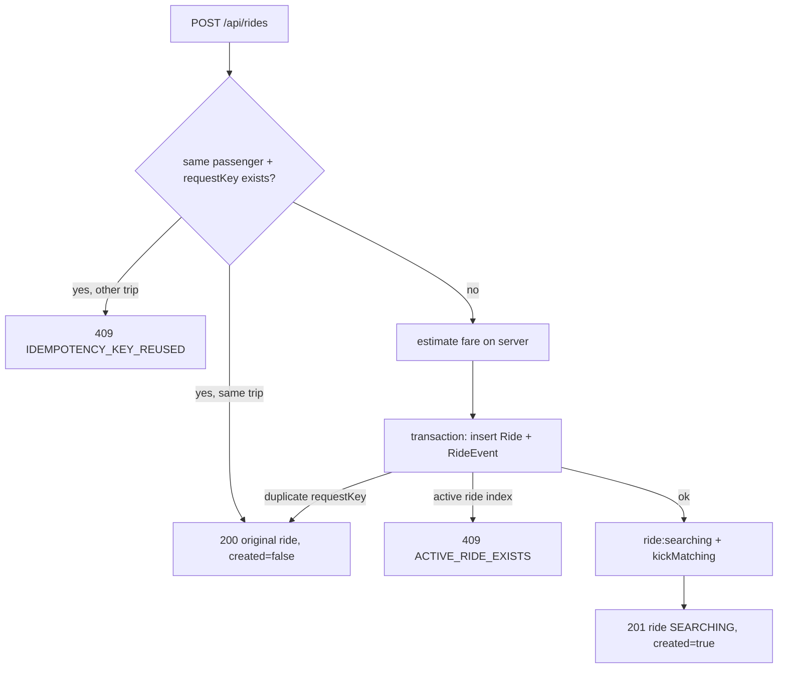

# 04 · Ride booking and API flow

> Previous: [03 Auth](03-authentication-and-authorization.md) · Next: [05 Progressive radius](05-progressive-radius-search.md)

## The basic idea

"Booking a ride" sounds like one action, but it is really two:

1. **Recording a request**: "Asha wants a car from A to B." This happens instantly.
2. **Finding a driver**: this can take up to a minute or two and might fail.

So a new ride starts in status **`SEARCHING`**, which means *"we are looking"*, **not** *"you have a car"*. Only `DRIVER_ASSIGNED` means a driver has actually committed. The UI is careful never to show a driver before the server says so ([11](11-realtime-communication-and-tracking.md), test #88).

## Step by step: a passenger requests a ride

1. **Frontend validation** (`client/src/components/BookingForm.jsx`, `validateBooking`): both places need an address *and* valid map coordinates, and they must differ. The "Request ride" button shows "Requesting…" and is disabled while the request is in flight, which prevents double submits (test #90).
2. **requestKey.** When the form first appears (and whenever the trip changes), the form generates a random `requestKey` (`newRequestKey()` → `crypto.randomUUID()`). If the request fails and the passenger clicks again, **the same key is re-sent**.
3. **HTTP request** `POST /api/rides` with `{ pickup, destination, vehicleType, passengerCount, driverPreference, paymentMethod, requestKey }`. No price, no passenger id. (`passengerCount` and `driverPreference` were added in the upgrade: see [18](18-vehicle-types-and-capacity.md) and [20](20-women-safety-and-matching-preferences.md).)
4. **Route + middleware** (`server/src/routes/index.js`): `authenticate` → `requireRole(PASSENGER)` → `limiters.booking` → `validate({ body: schemas.createRide })`.
5. **Controller** `rideController.create` calls `rideService.createRide(req.user.id, req.body)`.
6. **Idempotency check.** `existingForKey` looks for a ride with the same `passengerId` + `requestKey`. If found (and it's the same trip) → return it with `created: false` and HTTP `200`. If the key was used for a *different* trip → `409 IDEMPOTENCY_KEY_REUSED`.
7. **Fare estimation.** `fareService.estimateTrip(pickup, destination, vehicleType, passengerCount)` computes distance, duration and fare on the server ([10](10-fare-calculation.md)).
8. **Ride creation** inside a transaction: insert the `Ride` (`status: SEARCHING`, `active: true`) and a `RideEvent` of type `RIDE_REQUESTED`.
9. **Duplicate key race.** If two identical requests run at the same time, one insert fails with a duplicate-key error on `{ passengerId, requestKey }`; that request then returns the winner's ride. If instead the `one_active_ride_per_passenger` index fails, the passenger already has an active ride → `409 ACTIVE_RIDE_EXISTS`.
10. **Notify + start matching.** Socket event `ride:searching` to the passenger; `matchingService.kickMatching(rideId)` starts matching right after the response ([06](06-driver-matching-algorithm.md)).
11. **Response** `201 { ride, created: true }`.
12. The browser navigates to `/ride/:id`, where `useRideTracking` keeps the screen up to date.



## What is idempotency, concretely?

**Idempotent** = repeating the request has the same effect as sending it once. Networks fail in annoying ways: the server may create the ride but the reply gets lost, so the app retries. Without idempotency, the passenger would get two cars. With the `requestKey` + unique index, the retry returns the first ride. Tested in `booking.test.js` (#16, and #55 with 10 simultaneous identical requests → exactly one ride).

## Endpoint reference

All responses use `{ success: true, data }` or `{ success: false, error: { code, message, details? } }`. "Auth" means `Authorization: Bearer <jwt>`.

### `POST /api/rides/estimate` (passenger)

Request: `{ "pickup": { "lat": 12.9716, "lng": 77.5946 }, "destination": { "lat": 12.9352, "lng": 77.6245 }, "vehicleType": "CAR" }`

Response `200` (real output for MG Road → Koramangala; ₹130.90 rounds to ₹131):
```json
{ "distanceMeters": 5185, "durationSeconds": 747, "source": "straight_line", "isEstimate": true,
  "estimatedFare": 13100, "currency": "INR",
  "breakdown": { "basePaise": 5000, "distancePaise": 6222, "timePaise": 1868, "minimumApplied": false,
                 "distanceMeters": 5185, "durationSeconds": 747 },
  "vehicleType": "CAR" }
```
Errors: `400` invalid/missing coordinates, unknown fields, points closer than 100 m or farther than 200 km.

### `POST /api/rides` (passenger, rate-limited)

Request: `{ pickup: { address, lat, lng }, destination: { address, lat, lng }, vehicleType?, paymentMethod?: "CASH"|"ONLINE", requestKey }`
Response: `201 { ride, created: true }` or `200 { ride, created: false }`.
Errors: `400` validation (including any `fare`, `passengerId`, `driverId`, `status` field), `409 ACTIVE_RIDE_EXISTS`, `409 IDEMPOTENCY_KEY_REUSED`, `429`.

### `GET /api/rides/:rideId` (passenger owner, assigned driver, admin)

Response `200 { ride }` where `ride` comes from `buildRideView` (`server/src/services/rideView.js`): status, places, fares, the driver's name and vehicle (once assigned), the driver's latest location (only while assigned/arrived/in progress), and payment status.
Errors: `400` malformed id, `404` not found *or not yours*.

### `GET /api/rides/:rideId/events`

Timeline of `RideEvent`s (same access rules).

### `GET /api/rides/history?page=1&limit=20` (passenger)

Only the caller's rides, newest first: `{ items, total, page, limit }`.

### `POST /api/rides/:rideId/cancel` (passenger owner; admins use `POST /api/admin/rides/:rideId/cancel`)

Body: `{ "reason"?: string }`. Allowed from `SEARCHING`, `DRIVER_ASSIGNED`, `DRIVER_ARRIVED`. Repeating it returns `alreadyCancelled: true`. Errors: `409 INVALID_TRANSITION` (e.g. trip in progress), `403` driver, `404` not yours. Details in [09](09-ride-lifecycle.md).

### Driver and payment endpoints

Covered in [06](06-driver-matching-algorithm.md), [08](08-offer-acceptance-rejection-and-timeouts.md), [09](09-ride-lifecycle.md) and [10](10-fare-calculation.md). Full list of routes: `server/src/routes/index.js`.

## Real-time updates after booking

The passenger's browser receives `ride:searching` (also each time the radius grows, with `radiusKm`), then `ride:driver-assigned` or `ride:no-driver-found`. Each event makes `useRideTracking` re-fetch `GET /api/rides/:id`, the source of truth.

## What can go wrong

| Failure | What happens |
| --- | --- |
| Network drops after the server created the ride | Retry with same `requestKey` returns the same ride |
| Double-click | Button disabled + idempotency |
| Passenger already riding | `409 ACTIVE_RIDE_EXISTS`; `PassengerHome` also redirects to the active ride |
| Server crashes right after creating the ride, before matching starts | Recovery worker's `resumeStalledRides` starts matching after `WORKER_STALE_SEARCH_MS` |
| Nobody accepts | Ride ends as `NO_DRIVER_FOUND`, nothing charged |

Debug: `GET /api/rides/:id/events`, the admin "Rides → Inspect" panel, or `docker compose logs -f backend | grep ride`.

## Glossary

- **Idempotency key (`requestKey`)**: a unique value per booking attempt that lets the server recognise retries.
- **Rate limiting**: refusing requests when one client sends too many.
- **Validation**: checking input is well-formed before using it.
- **Source of truth**: the one place whose data wins in a disagreement (here: MongoDB via REST).
