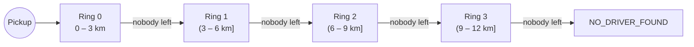

# 05 · Progressive-radius search

> Previous: [04 Booking](04-ride-booking-and-api-flow.md) · Next: [06 Matching algorithm](06-driver-matching-algorithm.md)

## The basic idea

When you request a ride, the best driver is usually the **closest** one: shorter wait, less fuel. But if nobody is close, we would rather send someone a bit farther away than nobody at all. So we search **in steps**:

1. first within 3 km,
2. then more than 3 km up to 6 km,
3. then more than 6 up to 9 km,
4. then more than 9 up to 12 km,
5. then give up with `NO_DRIVER_FOUND`.

Analogy: looking for your keys. You check your pockets first, then the room, then the house. You don't search the whole house first.

## Why rings, not growing circles?

A naive version searches "within 3 km", then "within 6 km". But "within 6 km" **includes** the first 3 km again, so drivers who already declined would be found again. Instead we search **rings** (bands) that do not overlap:



"(3 – 6 km]" means *greater than 3 km and at most 6 km*. A driver at exactly 3.000 km belongs to ring 0 only.

As an extra safety net, every driver who has been tried is stored in `ride.matching.attemptedDriverIds` and excluded from all later searches for that ride.

## The configuration

From `server/src/config/index.js` (environment variables in `.env.example`):

| Variable | Default | Meaning |
| --- | --- | --- |
| `MATCH_INITIAL_RADIUS_KM` | 3 | outer edge of ring 0 |
| `MATCH_RADIUS_STEP_KM` | 3 | width of each next ring |
| `MATCH_MAX_RADIUS_KM` | 12 | stop after this |
| `MATCH_CANDIDATE_PAGE_SIZE` | 10 | how many candidates one query returns |
| `LOCATION_FRESHNESS_MS` | 30000 | ignore drivers whose last location is older |

`buildRings()` in `server/src/services/matchingService.js` turns these into metres:

```js
buildRings({ initialRadiusKm: 3, radiusStepKm: 3, maxRadiusKm: 12 })
// [ { index: 0, minMeters: 0,    maxMeters: 3000 },
//   { index: 1, minMeters: 3000, maxMeters: 6000 },
//   { index: 2, minMeters: 6000, maxMeters: 9000 },
//   { index: 3, minMeters: 9000, maxMeters: 12000 } ]
```

If the maximum isn't a multiple of the step, the last ring is cut short (tested in `stateMachineAndRings.test.js`).

## Coordinates: why `[longitude, latitude]`?

People say "latitude, longitude" (12.97° N, 77.59° E for Bengaluru). GeoJSON, the format MongoDB uses, follows the maths convention *x, y*: **longitude first, then latitude**. So Bengaluru is stored as `[77.5946, 12.9716]`. Mixing them up silently puts points in the wrong place. All conversions go through `toPoint({ lat, lng })` and `fromPoint(point)` in `server/src/utils/geo.js`.

## How MongoDB finds nearby drivers

`DriverLocation` has a **2dsphere index** on `location`, so MongoDB can answer "which points are near this point?" efficiently. Three operators are involved:

- **`$near`** (and its aggregation form **`$geoNear`**) returns documents **sorted by distance**, nearest first.
- **`$maxDistance`** excludes anything farther than N **metres**.
- **`$minDistance`** excludes anything closer than N **metres**.

For GeoJSON points, distances are always in **metres**. Passing kilometres (3 instead of 3000) would search a 3-metre circle and find nobody. That is why rings store `minMeters` / `maxMeters`.

We use the aggregation stage `$geoNear` (the pipeline version of `$near`) because we need to **join** each location with its `DriverProfile` and filter on eligibility *before* limiting the number of results. `findCandidates()`:

```js
{ $geoNear: {
    near: ride.pickup.location,          // GeoJSON point of the pickup
    key: 'location',
    distanceField: 'distanceMeters',     // MongoDB writes each driver's distance here
    spherical: true,
    minDistance: ring.minMeters,
    maxDistance: ring.maxMeters,
    query: { updatedAt: { $gte: freshSince },            // fresh location only
             driverId: { $nin: excludeDriverIds } } } },  // never re-try a driver
// ring > 0 only: make the lower edge exclusive
{ $match: { distanceMeters: { $gt: ring.minMeters } } },
{ $lookup: { from: 'driverprofiles', localField: 'driverId', foreignField: 'userId', as: 'profile' } },
{ $unwind: '$profile' },
{ $match: { 'profile.approvalStatus': 'APPROVED', 'profile.availability': 'AVAILABLE',
            'profile.activeRideId': null, 'profile.vehicle.type': ride.vehicleType } },
{ $limit: cfg.candidatePageSize }
```

Line by line:

- `$geoNear` must be the first stage. It returns locations inside the ring, nearest first, each with `distanceMeters`.
- `query` drops stale locations (older than 30 s) and drivers already attempted.
- `$minDistance` is *inclusive*, so for rings after the first we add `$gt: minMeters` to make the boundary belong to the inner ring only.
- `$lookup` + `$unwind` attach each driver's profile.
- The final `$match` keeps only **eligible** drivers: approved, available, holding no ride, right vehicle type.
- `$limit` returns a "page" of candidates (see pagination below).

## Ranking, rejection and expansion

Within a ring, candidates are tried **nearest first, one at a time** ([06](06-driver-matching-algorithm.md)). What happens to each candidate:

| Outcome | Effect on search |
| --- | --- |
| Became unavailable before we could reserve them | skip; try next candidate immediately |
| Declined | offer `REJECTED`; next candidate |
| No answer within 15 s | offer `EXPIRED`; next candidate |
| Accepted | **search stops**; ride `DRIVER_ASSIGNED` |

When the query for the current ring returns **no** candidates, `moveToRing()` bumps `ride.matching.ringIndex`, records a `RADIUS_EXPANDED` event, sends `ride:searching` with the new `radiusKm`, and searches the next ring **immediately**. There is no waiting when a ring is empty (test #35).

When the last ring is exhausted, `markNoDriverFound()` sets `NO_DRIVER_FOUND`.

### Pagination: not silently skipping drivers

A query returns at most `MATCH_CANDIDATE_PAGE_SIZE` drivers. If all of them fail to be reserved, the loop queries the **same ring again**; since they are now in `attemptedDriverIds`, the next page comes back. We only leave a ring when a query returns zero eligible drivers. Test #37 uses a page size of 2 with six drivers to prove none are skipped.

## Worked example

Pickup: MG Road. Drivers online:

| Driver | Distance | State |
| --- | --- | --- |
| Ravi | 1.0 km | available |
| Sunil | 2.0 km | available |
| Kiran | 2.5 km | **offline** |
| Meena | 4.5 km | available |
| Dev | 13 km | available |

1. Ring 0 (0–3 km): eligible = Ravi, Sunil (Kiran is offline, filtered out). Offer → Ravi. Ravi **declines**.
2. Ring 0 again: eligible = Sunil (Ravi now attempted). Offer → Sunil. Sunil **doesn't answer**; after 15 s the offer **expires**.
3. Ring 0 again: nobody left → `RADIUS_EXPANDED` to 6 km.
4. Ring 1 (3–6 km): Meena. Offer → Meena. Meena **accepts** → `DRIVER_ASSIGNED`. Search stops; rings 2–3 are never searched. Dev (13 km) would never have been considered anyway.

This is exactly the scenario in `server/tests/e2e/booking-flow.test.js` and in the manual demo with `npm run simulate:drivers`.

## Straight-line vs road distance

MongoDB measures **straight-line** (great-circle) distance, "as the crow flies". A driver 2 km away in a straight line might be 4 km by road (a river, a one-way street). We use straight-line distance for **finding** drivers because it is fast and indexable; that's standard practice. Fare estimation can optionally use real road distance via OSRM ([10](10-fare-calculation.md)).

## What can go wrong

| Problem | Prevention | Debug |
| --- | --- | --- |
| Driver offered twice after expansion | non-overlapping rings + `attemptedDriverIds` (#27, #28) | admin ride inspector shows each offer once |
| km passed instead of metres | rings store metres | `buildRings` unit test |
| Drivers with old GPS matched | freshness filter (#31) | admin Drivers tab shows "stale" |
| Index missing | `ensureIndexes()` at startup | `db.driverlocations.getIndexes()` in mongosh |

## Glossary

- **Ring**: the area between two circles around the pickup.
- **Great-circle distance**: shortest distance over the Earth's surface; what `$geoNear` computes.
- **`$geoNear` / `$near`**: MongoDB operators returning documents ordered by distance.
- **2dsphere index**: an index for points on a sphere.
- **Eligible driver**: approved, available, free, fresh location, matching vehicle, not yet tried.
- **Pagination**: fetching results in chunks.

## Upgrade: extra eligibility rules (radius logic unchanged)

The final `$match` stage now also applies `rideEligibilityFilter(ride, 'profile.')` from `services/driverEligibility.js`: same **vehicle type**, **capacity ≥ passenger count**, and for `FEMALE_ONLY` rides **admin-verified** women-driver eligibility. The rings, ordering, pagination and boundaries are unchanged, and tests show expansion still works with the new filters (for example a women-only ride skipping ring 0 and being offered in rings 1 and 2). See [18](18-vehicle-types-and-capacity.md) and [20](20-women-safety-and-matching-preferences.md).
