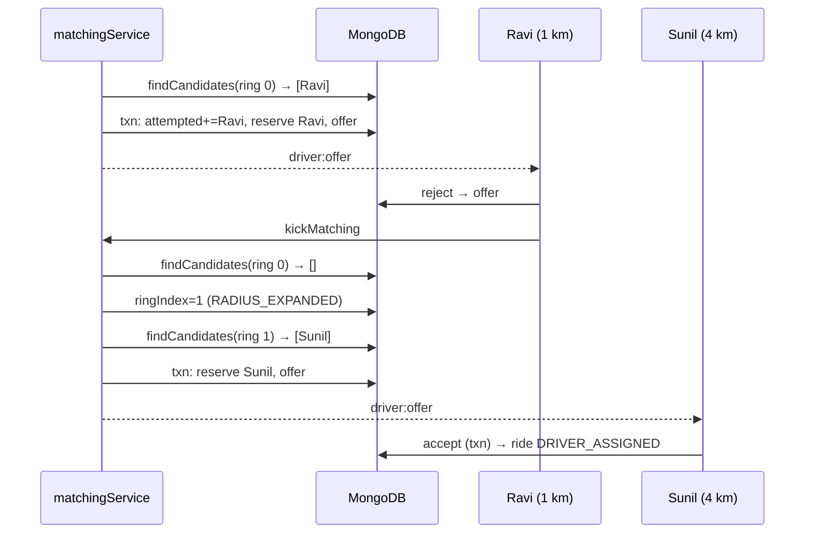

# 06 · Driver matching algorithm

> Previous: [05 Progressive radius](05-progressive-radius-search.md) · Next: [07 Concurrency](07-concurrency-consistency-and-atomic-operations.md)

## The basic idea

Matching connects one ride to one driver. Two words must be kept apart:

- **Searching** for a driver = *asking the database who is nearby*. This is only a **snapshot**; it may be out of date a millisecond later.
- **Reserving** a driver = *atomically marking them as held for this ride*, so nobody else can offer them work. Only a successful reservation counts.

A driver who appeared in the search might be gone by the time we try to reserve them (they went offline, or another ride grabbed them). The algorithm expects this and simply moves on.

We send offers **sequentially**: one driver at a time, waiting for their answer, so a driver never accepts a ride that someone else already took, and passengers get the closest willing driver.

## Pseudocode

```text
advanceMatching(ride):
  take the ride's lease (or ask the current holder to re-run, then stop)
  repeat runMatchingStep(ride) until nobody asked for another run
  release the lease

runMatchingStep(ride):
  if ride is not SEARCHING: stop
  if ride has a PENDING offer:
      if not expired yet: stop (we are waiting for the driver)
      else expire it (releasing the driver)
  ring = ride.matching.ringIndex
  while ring < number of rings:
      candidates = eligible drivers in ring, nearest first, not yet attempted
      if none:
          ring = ring + 1  (record RADIUS_EXPANDED)
          continue
      for each candidate:
          in ONE transaction:
              add candidate to attemptedDriverIds
              try to reserve candidate (only if still AVAILABLE and free)
              if reserved: create PENDING offer with expiresAt = now + 15 s
          if reserved:
              start a 15 s timer; notify the driver; stop (wait)
          else: try next candidate
  mark ride NO_DRIVER_FOUND
```

The algorithm **never sleeps or waits** inside a step. Waiting is represented by data: a `PENDING` offer with an `expiresAt`. The next step is triggered by an event:

| Trigger | Who calls `advanceMatching` |
| --- | --- |
| Ride created | `rideService.createRide` → `kickMatching` |
| Driver declines | `offerService.rejectOffer` → `kickMatching` |
| Offer timer fires | `matchingService.handleOfferTimeout` |
| Process crashed / timer lost | `RecoveryWorker.expireOffers` and `resumeStalledRides` |

## The real code

All in `server/src/services/matchingService.js`.

### Candidate discovery: `findCandidates(ride, ring, excludeDriverIds)`

The `$geoNear` aggregation explained in [05](05-progressive-radius-search.md). It already applies every eligibility rule: approved, `AVAILABLE`, `activeRideId: null`, fresh location (`LOCATION_FRESHNESS_MS`), matching `vehicleType`, not in `attemptedDriverIds`. It returns the nearest first.

### Reservation + offer: `reserveAndOffer(rideId, candidate, ring)`

```js
return withTransactionOrAbort(async (session) => {
  const ride = await Ride.findOneAndUpdate(
    { _id: rideId, status: 'SEARCHING' },
    { $addToSet: { 'matching.attemptedDriverIds': candidate.driverId }, $set: { ... } },
    { new: true, session });
  if (!ride) throw new AbortTransaction({ notSearching: true }); // e.g. cancelled meanwhile

  const profile = await reserveDriver(candidate.driverId, rideId, { session, now });
  if (!profile) return { skipped: true };      // lost the race: driver no longer free

  const [offer] = await RideOffer.create([{ rideId, driverId, ringIndex, distanceMeters,
                                            offeredAt: now, expiresAt: now + offerTimeoutMs }], { session });
  await Ride.updateOne({ _id: rideId }, { $set: { 'matching.currentOfferId': offer._id } }, { session });
  await RideEvent.create([{ rideId, eventType: 'OFFER_SENT', ... }], { session });
  return { offer, ride };
});
```

- Everything is in **one transaction**. If creating the offer fails, the reservation is rolled back too, so there is no "orphaned" reserved driver (test #56).
- `reserveDriver` (in `driverReservation.js`) is the atomic conditional update:

```js
DriverProfile.findOneAndUpdate(
  { userId, availability: 'AVAILABLE', activeRideId: null, approvalStatus: 'APPROVED' },
  { $set: { availability: 'RESERVED', activeRideId: rideId, reservedAt: now } },
  { new: true, session });
```

  If another ride reserved this driver a moment ago, the filter no longer matches, the result is `null`, and we skip to the next candidate (test #34).
- The driver is still recorded in `attemptedDriverIds` when skipped, so we don't loop on them.

### After commit: notify and set a timer

Only **after** the transaction commits do we call `offerTimers.schedule(offer, handleOfferTimeout)` and `notifyOffer()` (socket `driver:offer`). Notifying earlier could tell a driver about an offer that was then rolled back.

### Expanding and failing

`moveToRing()` advances `matching.ringIndex` with a conditional update (`ringIndex: fromIndex`, `status: SEARCHING`) so two processes can't both skip a ring. `markNoDriverFound()` changes `SEARCHING → NO_DRIVER_FOUND` in a transaction with its `RideEvent`.

## Persisting progress and recovering after a restart

Everything needed to continue lives in MongoDB:

- `ride.matching.ringIndex`: where we are.
- `ride.matching.attemptedDriverIds`: who has been tried.
- `RideOffer` documents with `status` and `expiresAt`: what we are waiting for.

So if the server dies mid-search, nothing is lost. When the recovery worker runs:

1. An expired `PENDING` offer is expired and matching continues (`expireOffers`).
2. A `SEARCHING` ride with no open offer, whose lease has expired and which made no progress for `WORKER_STALE_SEARCH_MS`, is resumed (`resumeStalledRides`).

Test #77 simulates a crashed process that left an expired lease behind; the worker resumes matching from ring 1.

## The lease: one matcher per ride at a time

Several things can call `advanceMatching` for the same ride at once (a reject request + a worker sweep). Running two steps concurrently could create two offers. So `advanceMatching` first claims a **lease** (a time-limited lock) stored on the ride:

```js
Ride.findOneAndUpdate(
  { _id: rideId, status: 'SEARCHING',
    $or: [{ 'matching.lockedUntil': null }, { 'matching.lockedUntil': { $lte: now } }] },
  { $set: { 'matching.lockOwner': owner, 'matching.lockedUntil': now + MATCH_LEASE_MS } });
```

- If someone else holds it, we `$inc` `matching.kicks` and leave. The holder releases the lease only if `kicks` hasn't changed (`updateOne({ lockOwner: owner, kicks })`); if it changed, the holder runs another step. So a "please re-run" request is never lost.
- If a process dies holding the lease, `lockedUntil` passes and anyone can take over.
- The `one_pending_offer_per_ride` unique index is a final safety net: even with a bug, MongoDB refuses a second `PENDING` offer for a ride.

Test: "concurrent advanceMatching calls for one ride send exactly one offer (lease)" in `concurrency.test.js`.

## Example timeline



## What can go wrong

| Situation | Handling | Test |
| --- | --- | --- |
| Candidate grabbed by another ride | reservation returns `null`; next candidate | #34, #49 |
| Ride cancelled while matching | `reserveAndOffer` aborts (`notSearching`) | #48 |
| Failure inside the offer transaction | everything rolls back, lease released | #56 |
| Process crash while waiting | worker expires offer and continues | #73, #77 |
| Unapproved / stale / offline / wrong vehicle | filtered in `findCandidates` | #10, #29–#31, #36 |

Debugging: the admin ride inspector lists every offer (status, ring, distance) and the event timeline. Logs show `offer sent` and `offer expired` lines with ride and driver ids.

## Glossary

- **Candidate**: a driver who looked eligible in the search snapshot.
- **Reservation**: an atomic hold on a driver for one ride.
- **Sequential offers**: one driver at a time.
- **Lease**: a lock that expires automatically, so a crashed holder can't block forever.
- **Commit**: the moment a transaction's changes become permanent and visible.

## Upgrade: eligibility re-checked atomically

`reserveDriver(driverId, rideId, { eligibility })` now includes the ride's eligibility filter in its conditional update, and `acceptOffer` includes it in the driver update inside its transaction. So the vehicle type, capacity and women-driver rules are enforced **at the moment of reservation and acceptance**, not only during the search. If no eligible driver accepts, `markNoDriverFound` records `noDriverReason` (`NO_ELIGIBLE_DRIVER` or `PREFERENCE_UNAVAILABLE`). Offers no longer include the destination ([16](16-otp-and-trip-verification.md)).
