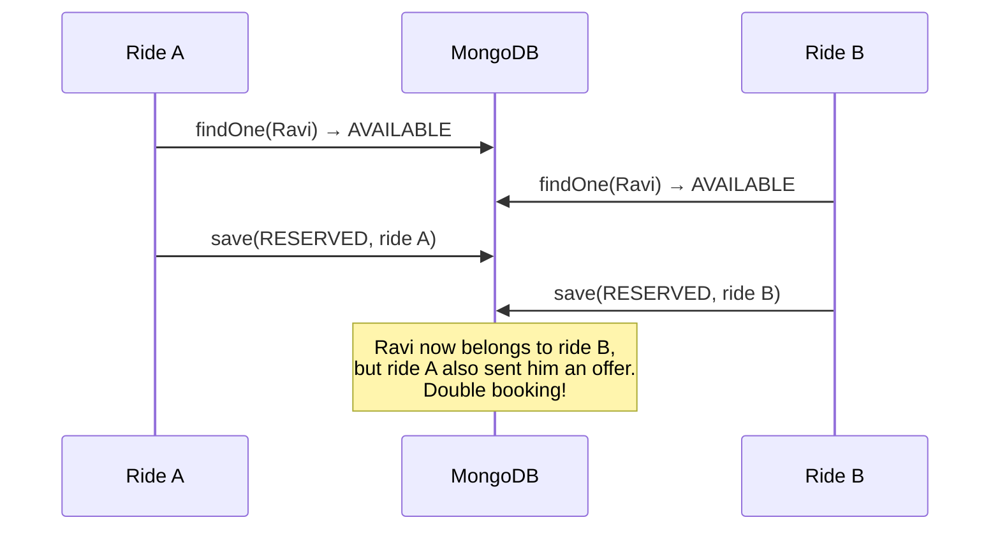
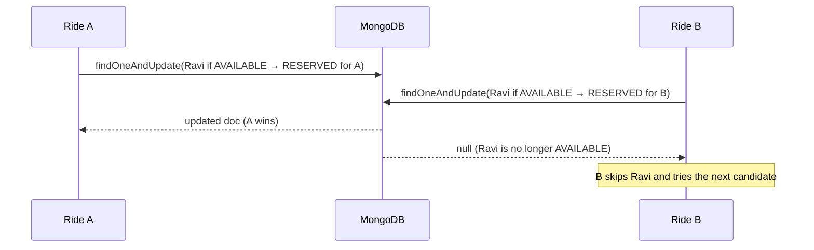

# 07 · Concurrency, consistency and atomic operations

> Previous: [06 Matching](06-driver-matching-algorithm.md) · Next: [08 Offers and timeouts](08-offer-acceptance-rejection-and-timeouts.md)

This is the most important document in the set. Take it slowly.

## What is concurrency?

**Concurrency** means several things happening *at the same time*. Our server handles many requests at once: two passengers book at the same second; a driver taps "Accept" while the passenger taps "Cancel"; the recovery worker expires an offer while the driver accepts it.

Each request runs a sequence of steps. When two sequences touch the same data, their steps can **interleave** in surprising orders.

## What is a race condition?

A **race condition** is a bug where the result depends on *who gets there first*, and some orderings produce a wrong result.

Real-world analogy: two people check a shared calendar, both see "Room 3 free at 2 pm", both write their meeting in. Each checked; it still went wrong, because the **check** and the **write** were separate steps.

## The classic bug: read, then write

Here is how you might naively reserve a driver. **This is the bad version; it is not in the codebase.**

```js
// BAD: check-then-act
const driver = await DriverProfile.findOne({ userId });
if (driver.availability === 'AVAILABLE') {
  driver.availability = 'RESERVED';
  driver.activeRideId = rideId;
  await driver.save();
}
```

Two passengers, one driver (Ravi):



Both rides read "AVAILABLE" before either wrote. Both "won".

## The fix: an atomic conditional update

An **atomic operation** happens completely or not at all, and nobody can see it half-done or sneak in between its parts. MongoDB guarantees that **a single update to a single document is atomic**, including the check in its filter.

So we put the check *inside* the update. **This is the actual code** (`server/src/services/driverReservation.js`, `reserveDriver`):

```js
// GOOD: check and change in ONE atomic operation
return DriverProfile.findOneAndUpdate(
  { userId: driverUserId, availability: 'AVAILABLE', activeRideId: null, approvalStatus: 'APPROVED' }, // condition
  { $set: { availability: 'RESERVED', activeRideId: rideId, reservedAt: now } },                     // change
  { new: true, session }
);
```

MongoDB finds the document **and** applies the change while holding it, so only one of two simultaneous calls can match the condition:



`null` is not an error. It simply means "someone else won the race", and the caller moves on. This pattern is sometimes called **optimistic** concurrency: don't lock first; attempt the change *only if* the state is still what you expect.

The same pattern is used everywhere state changes:

| Change | Condition in the filter | File |
| --- | --- | --- |
| Reserve driver | `AVAILABLE`, `activeRideId: null`, `APPROVED` | `driverReservation.js` |
| Release reservation | `RESERVED` **and** `activeRideId: <this ride>` | `driverReservation.js` |
| Accept offer | `PENDING`, mine, `expiresAt > now` | `offerService.js` |
| Expire / reject offer | `PENDING` | `offerService.closeOffer` |
| Assign ride | ride `SEARCHING`, `driverId: null` | `offerService.acceptOffer` |
| Arrive/start/complete | ride in the expected `from` status, `driverId: me` | `rideService.driverTransition` |
| Driver goes online/offline | `availability ∈ {OFFLINE, AVAILABLE}`, `activeRideId: null` | `driverService.setAvailability` |
| Payment settles | `status: PROCESSING` | `paymentService.applyProviderResult` |

## When one document isn't enough: transactions

Accepting an offer must change **three** documents:

1. `RideOffer`: `PENDING → ACCEPTED`
2. `Ride`: `SEARCHING → DRIVER_ASSIGNED`, `driverId = driver`
3. `DriverProfile`: `RESERVED → ON_TRIP`

If the server crashed after step 1, we'd have an accepted offer for a ride with no driver. A **multi-document transaction** groups changes so they **all commit or none do**.

`server/src/utils/transaction.js`:

```js
async function withTransaction(fn) {
  const session = await mongoose.startSession();
  try {
    let result;
    await session.withTransaction(async () => { result = await fn(session); },
      { readConcern: { level: 'snapshot' }, writeConcern: { w: 'majority' } });
    return result;
  } finally { await session.endSession(); }
}
```

- Every write inside passes `{ session }` to join the transaction.
- If two transactions modify the same document, MongoDB detects a **write conflict**; `session.withTransaction` automatically **retries** the loser, which then re-reads the fresh state and usually finds its condition no longer holds.
- `withTransactionOrAbort` lets code throw `new AbortTransaction(value)` to roll back and return a value (e.g. "ride not searching") instead of an error.

`offerService.acceptOffer` (simplified):

```js
withTransactionOrAbort(async (session) => {
  const accepted = await RideOffer.findOneAndUpdate(
    { _id: offerId, driverId: me, status: 'PENDING', expiresAt: { $gt: now } },
    { $set: { status: 'ACCEPTED', respondedAt: now } }, { new: true, session });
  if (!accepted) throw new AbortTransaction({ error: conflict(...) });

  const ride = await Ride.findOneAndUpdate(
    { _id: accepted.rideId, status: 'SEARCHING', driverId: null },
    { $set: { status: 'DRIVER_ASSIGNED', driverId: me, assignedAt: now } }, { new: true, session });
  if (!ride) throw new AbortTransaction({ error: conflict(...) });   // rolls back the offer change too

  const driver = await DriverProfile.findOneAndUpdate(
    { userId: me, availability: 'RESERVED', activeRideId: accepted.rideId, approvalStatus: 'APPROVED' },
    { $set: { availability: 'ON_TRIP' } }, { new: true, session });
  if (!driver) throw new AbortTransaction({ error: conflict(...) });

  await RideEvent.create([{ eventType: 'DRIVER_ASSIGNED', ... }], { session });
});
```

Rules we follow for transactions:

- **Keep them short.** No waiting for drivers and no network calls inside. Waiting is modelled with `expiresAt`.
- **Notify after commit.** Socket events are sent after the transaction returns. If we notified inside and the transaction rolled back, the passenger would be told about a driver who was never assigned.
- **Conditions still matter.** Transactions alone don't express "only if AVAILABLE"; the conditional filters do.

## Why a replica set?

MongoDB only supports multi-document transactions on a **replica set** (a group of MongoDB servers keeping copies of the data) or a sharded cluster. A transaction relies on the **oplog** (the replica set's ordered log of operations) to commit atomically. A standalone `mongod` has no oplog, so transactions fail with *"Transaction numbers are only allowed on a replica set member or mongos"*.

For local development we run a **single-node replica set** (`--replSet rs0` in `docker-compose.yml`, initialised by `mongo/init-replica-set.js`). It enables transactions and change streams, but it has **one** server, so it provides **no high availability**. Production would use at least three members (or MongoDB Atlas).

## Unique indexes: the database's own guard rails

Some rules are about "there must never be two of X". The safest place to enforce that is the database, because it holds even if application code has a bug:

| Unique index | Prevents |
| --- | --- |
| `rides {passengerId, requestKey}` | two rides from one booking retry |
| `rides {passengerId}` where `active: true` | two active rides for one passenger |
| `rideoffers {rideId}` where `status: PENDING` | two simultaneous offers for one ride |
| `rideoffers {rideId, driverId}` | offering one ride to the same driver twice |
| `driverlocations {driverId}` | duplicate location docs from concurrent first updates |
| `payments {rideId}` | two payments for one ride |
| `users {email}`, `driverprofiles {userId}`, `{vehicle.registrationNumber}` | duplicate accounts/profiles/vehicles |

When an index refuses a write, MongoDB throws error code `11000`. Our code catches it where it's an expected outcome (`isDuplicateKeyError` in `rideService.createRide` and `driverService.updateLocation`).

## Idempotent requests

**Idempotent** means doing it twice = doing it once. Phones retry on flaky networks, so every important endpoint tolerates repeats:

| Request | Repeat behaviour |
| --- | --- |
| `POST /api/rides` (same `requestKey`) | returns original ride |
| `POST /api/offers/:id/accept` | `200` with `alreadyAccepted: true`, no new effects |
| `POST /api/offers/:id/reject` | `200` with `alreadyRejected: true` |
| `POST /api/rides/:id/cancel` | `200` with `alreadyCancelled: true` |
| `POST /api/rides/:id/arrive` / `complete` | `200` with `alreadyDone: true` (no new payment/event) |
| `POST /api/rides/:id/start` | `409`: a trip can't start twice |
| Payment webhook | duplicate `SUCCEEDED` → `200`, `duplicate: true` |

## Four tools, four jobs

| Tool | Guarantees | Example |
| --- | --- | --- |
| **Atomic single-document update** | check + change on one document can't be interleaved | reserve a driver |
| **Multi-document transaction** | several documents change together or not at all | accept an offer |
| **Unique index** | a duplicate can never be stored, whatever the code does | one ride per `requestKey` |
| **Idempotent request** | a repeated request causes no extra effects | retry of accept/complete |

## Consistency in this application

"Consistent" means the documents never contradict each other. Invariants we protect:

- A driver with `availability: RESERVED` has exactly one `PENDING` offer for `activeRideId`.
- A driver with `ON_TRIP` is the `driverId` of an assigned / arrived / in-progress ride.
- A `CANCELLED`, `COMPLETED` or `NO_DRIVER_FOUND` ride has no driver still pointing at it.
- A ride has at most one `ACCEPTED` offer.

## Socket.IO is not the source of truth

Socket events can be lost (phone in a tunnel), duplicated, or arrive late. So events are treated as hints. The client re-fetches the ride over REST after each event and after reconnecting ([11](11-realtime-communication-and-tracking.md)). The database decides.

## Cancellation racing acceptance

Passenger cancels while the driver accepts. Both are transactions touching the same ride document, so MongoDB serialises them:

- **Cancel first**: ride `CANCELLED`, offer `CANCELLED`, driver released. Accept then finds the offer not `PENDING` → `409`.
- **Accept first**: ride `DRIVER_ASSIGNED`. Cancel then sees `DRIVER_ASSIGNED` (still cancellable) → ride `CANCELLED`, driver `ON_TRIP → AVAILABLE`.

Either way the final state is consistent: a cancelled ride with a free driver. Test #53 runs this race six times.

## Stale reservation cleanup

Release operations always include *which ride* they're releasing:

```js
DriverProfile.updateOne(
  { userId: driverUserId, availability: 'RESERVED', activeRideId: rideId },   // only if still held by THIS ride
  { $set: { availability: 'AVAILABLE', activeRideId: null, reservedAt: null } });
```

So a late "release for old ride" can never free a driver who is now reserved for a different ride (test #57). The recovery worker uses the same pattern for abandoned reservations ([14](14-error-handling-and-recovery.md)).

## The concurrency tests and their results

All in `server/tests/integration/concurrency.test.js` (plus related files), run with **real concurrent requests against a real MongoDB replica set**, with no mocks of the database. Last run: **all passed**.

| # | Scenario | How it's tested | Result |
| --- | --- | --- | --- |
| 49 | 2 passengers, 1 driver | `Promise.all` of two `advanceMatching`, 5 rounds | exactly 1 offer, driver reserved for that ride |
| 50/58 | 2 drivers accept same ride | unique index temporarily dropped to force 2 PENDING offers; concurrent HTTP accepts, 5 rounds | one `200`, one `409`; 1 ACCEPTED offer |
| 51 | 10 accepts of same offer | 10 concurrent HTTP requests | 1 real acceptance, 9 idempotent replies, 1 event |
| 53 | cancel vs accept | concurrent HTTP, 6 rounds | always CANCELLED + driver free |
| 54 | failure inside accept transaction | last write forced to throw | offer still PENDING, ride SEARCHING, driver RESERVED |
| 55 | duplicate bookings | 10 concurrent identical `POST /api/rides` | 1 ride |
| 56 | failure inside reserve/offer | offer insert forced to throw | driver AVAILABLE, lease released |
| 57 | stale release | release for old ride | driver still held by new ride |
| 59 | concurrent location updates | 15 concurrent PATCHes for a new driver | 1 DriverLocation |
| — | 8 concurrent `advanceMatching` on one ride | lease | 1 offer |
| — | 8 rides, 3 drivers | concurrent matching | 3 offers, 3 distinct drivers |

## How to debug a suspected race

1. Open the ride in the admin inspector; look at the timeline and offers.
2. `docker compose exec mongo mongosh uber` → `db.driverprofiles.find({ availability: { $ne: 'OFFLINE' } })` to check reservations against `db.rideoffers.find({ status: 'PENDING' })`.
3. Grep logs for the ride id: `docker compose logs backend worker | grep <rideId>`.

## Glossary

- **Concurrency**: multiple operations in progress at the same time.
- **Race condition**: a bug that depends on timing/order.
- **Atomic**: all-or-nothing and indivisible.
- **Conditional update**: an update that applies only if the document still matches a filter.
- **Optimistic concurrency**: try the change under a condition instead of locking first.
- **Transaction**: group of changes committed together; rolled back together on failure.
- **Write conflict**: two transactions changing the same document; one is retried.
- **Replica set / oplog**: a group of MongoDB servers and their ordered operation log.
- **Unique index**: database rule forbidding duplicates.
- **Idempotent**: repeat-safe.
- **Invariant**: a rule that must always be true.

## Upgrade: new concurrency-sensitive workflows and their tests

The same tools (conditional updates, transactions, unique indexes, leases, idempotency) protect every new feature. All of these were tested with real concurrent operations against MongoDB:

| Workflow | Protection | Test |
| --- | --- | --- |
| 5 simultaneous trip starts with the right code | code `ACTIVE→VERIFIED` + ride status, in one transaction | `tripOtp.test.js` |
| 5 simultaneous completions | same + payment unique per ride | `tripOtp.test.js` |
| 5 simultaneous login-code verifications | conditional single use | `authProviders.test.js` |
| 5 simultaneous first Google sign-ins | unique external identity + re-check (a race found here was fixed) | `authProviders.test.js` |
| 5 simultaneous reviews | unique `{rideId, reviewerId, revieweeId}`; stats `$inc` in the same transaction | `reviews.test.js` |
| repeated chat sends (same `clientMessageId`) | unique index, idempotent return | `chat.test.js` |
| repeated safety presses | partial unique "one open incident" | `safety.test.js` |
| 3 workers retrying one emergency dispatch | lease (`lockedUntil`) | `safety.test.js` |
| concurrent uploads of one document type | partial unique "one current document" + transaction | `driverDocuments.test.js` |
| two women-only rides, one verified driver | atomic reservation with eligibility | `preferences.test.js` |
| two migration runners | atomic claim in `migrations` | `migrations.test.js` |

External notifications (sockets, SMS, emergency webhooks) are always sent **after** the database change commits.
