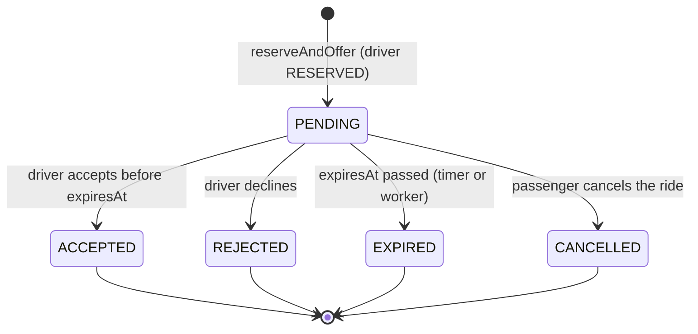

# 08 · Offer acceptance, rejection and timeouts

> Previous: [07 Concurrency](07-concurrency-consistency-and-atomic-operations.md) · Next: [09 Ride lifecycle](09-ride-lifecycle.md)

## The basic idea

An **offer** is a time-limited question to one driver: *"Will you take this ride? You have 15 seconds."* It's stored as a `RideOffer` document so that the question, its deadline and its answer survive crashes and can be audited.

## Offer states



Only `PENDING` can change. Every transition is a conditional update with `status: 'PENDING'` in the filter, so whichever of accept / reject / expire / cancel arrives first wins, and the others find nothing to change.

## Lifecycle step by step

### 1. Creating the offer (and reserving the driver)

`matchingService.reserveAndOffer` in one transaction:

- reserves the driver (`AVAILABLE → RESERVED`, `activeRideId = ride`),
- creates `RideOffer { status: 'PENDING', offeredAt: now, expiresAt: now + OFFER_TIMEOUT_MS }`,
- records `OFFER_SENT`.

### 2. Notifying the driver

After commit: `offerTimers.schedule(offer, handleOfferTimeout)` and socket `driver:offer` to the room `user:<driverId>` with pickup, estimated fare, distance to pickup, approximate trip length, rider count and `expiresAt`. Since the upgrade the **destination is not included** ([16](16-otp-and-trip-verification.md)). The driver app (`client/src/pages/DriverHome.jsx`) also polls `GET /api/drivers/me/offers`, so a missed socket event still shows the offer. `OfferCard.jsx` counts down to `expiresAt` and disables the buttons at zero.

### 3a. Accepting: `POST /api/offers/:offerId/accept`

`offerService.acceptOffer`:

1. Load the offer; `404` if missing, `403` if it belongs to another driver.
2. Already `ACCEPTED` by you → `200 { alreadyAccepted: true }` (idempotent).
3. Not `PENDING` → `409 OFFER_NOT_PENDING`.
4. Driver not approved → `403`.
5. Transaction: offer `PENDING` (not expired) → `ACCEPTED`; ride `SEARCHING` → `DRIVER_ASSIGNED`; driver `RESERVED` → `ON_TRIP`; event `DRIVER_ASSIGNED`. Any failed condition rolls everything back → `409`.
6. After commit: cancel the timer, emit `ride:driver-assigned` to passenger and driver.

### 3b. Rejecting: `POST /api/offers/:offerId/reject`

`offerService.rejectOffer` → `closeOffer(..., 'REJECTED')`: offer → `REJECTED`, `releaseReservation(driver, ride)`, clear `ride.matching.currentOfferId`, event `OFFER_REJECTED`. Then `kickMatching(rideId)` tries the next candidate. Repeating returns `alreadyRejected: true`.

### 3c. Timing out

`offerService.expireOffer(offerId)` → `closeOffer({ _id, expiresAt: { $lte: now } }, 'EXPIRED')`. It succeeds only if the offer is **still `PENDING` and really past its deadline**. Then socket `driver:offer-expired` and matching continues.

### 4. Releasing the reservation safely

```js
// driverReservation.releaseReservation
DriverProfile.updateOne(
  { userId: driverUserId, availability: 'RESERVED', activeRideId: rideId },
  { $set: { availability: 'AVAILABLE', activeRideId: null, reservedAt: null } });
```

The `activeRideId: rideId` condition means: release only if the driver is still reserved **for this ride** (test #46).

### 5. Late responses

A driver who taps "Accept" at second 16: the filter `expiresAt: { $gt: now }` fails → `409`. Even if the expiry hasn't been *processed* yet, a late accept can't win; once processed, the offer is `EXPIRED` and stays that way (tests #41, #43).

## Why `setTimeout` alone is not enough

`offerTimers.js` keeps an in-memory `setTimeout` per offer so expiry happens promptly (~15 s). But memory disappears when the process restarts, crashes, or is redeployed. If expiry depended only on that timer, a crash would leave:

- the offer `PENDING` forever,
- the driver `RESERVED` forever (never offered other work),
- the passenger stuck on "Finding you a driver".

So the deadline is **stored in MongoDB** (`expiresAt`), and a separate process sweeps for overdue offers.

## The database-backed recovery worker

`server/src/workers/recoveryWorker.js`, class `RecoveryWorker`. Every `WORKER_INTERVAL_MS` (default 5 s) `runOnce()` does:

```js
const due = await RideOffer.find({ status: 'PENDING', expiresAt: { $lte: new Date() } })
  .sort({ expiresAt: 1 }).limit(BATCH);
for (const o of due) {
  const closed = await offerService.expireOffer(o._id); // the atomic "claim"
  if (!closed) continue;                               // someone else handled it
  await matchingService.advanceMatching(closed.rideId);
}
```

**How several workers coordinate without Redis or Celery:** the `find` is just a list of *candidates*. The real **claim** is `expireOffer`'s conditional update `PENDING → EXPIRED`. MongoDB applies it atomically, so if two workers (or a worker and a timer) try at once, exactly one gets the document back; the others get `null` and skip it. The follow-up matching is protected by the per-ride lease ([06](06-driver-matching-algorithm.md)). Tests: #75 runs two workers in parallel, and five simultaneous `expireOffer` calls produce exactly one winner.

The worker runs as its own container (`worker` in `docker-compose.yml`, `npm run worker`). Without Docker you can set `RUN_WORKER_IN_PROCESS=true` to run it inside the API process.

## Timeline example

```text
10:00:00.000  Offer#1 → Sunil, PENDING, expiresAt 10:00:15.000. Timer set in API process.
10:00:05.000  API process restarts (deploy). Timer lost. Offer still PENDING in MongoDB.
10:00:15.000  Deadline passes. Nobody is listening in memory.
10:00:17.300  Recovery worker pass: finds Offer#1 (PENDING, expired).
              expireOffer: PENDING → EXPIRED ✔, Sunil RESERVED → AVAILABLE ✔, event OFFER_EXPIRED
              advanceMatching: Offer#2 → Meena
10:00:18.100  Sunil taps "Accept" (late) → 409 OFFER_NOT_PENDING
```

## Preventing duplicate processing

- Conditional `PENDING` filter on every transition (one winner).
- `one_pending_offer_per_ride` unique index (never two open offers per ride).
- `{ rideId, driverId }` unique index (never the same driver twice per ride).
- Idempotent accept/reject replies.

## What can go wrong and how to inspect

| Symptom | Likely cause | Check |
| --- | --- | --- |
| Offers never expire | worker not running | `docker compose ps worker`, `docker compose logs -f worker` |
| Driver stuck `RESERVED` | crash between steps (rare; transactions prevent it) | worker `reconcileDrivers` fixes after `WORKER_RESERVATION_GRACE_MS` |
| Driver sees offer that then vanishes | passenger cancelled; driver got `driver:offer-expired` with `reason: 'cancelled'` | admin ride timeline |

`db.rideoffers.find({ status: 'PENDING' })` in mongosh lists open offers with their deadlines.

## Glossary

- **Offer**: a time-limited invitation to one driver.
- **Expiry / deadline (`expiresAt`)**: after this moment, the offer cannot be accepted.
- **Claim**: atomically taking ownership of a task so nobody else processes it.
- **Recovery worker**: background process that finishes work interrupted by crashes or lost timers.
- **Timer**: an in-memory callback (`setTimeout`); fast but lost on restart.

## Upgrade: accepting also creates the pickup code

The accept transaction now also issues the passenger's trip-start code (`rideOtpService.issue`), and checks the ride's eligibility rules (vehicle type, capacity, women-driver verification) in the driver update. After commit the passenger receives `ride:otp-available`. See [16](16-otp-and-trip-verification.md).
