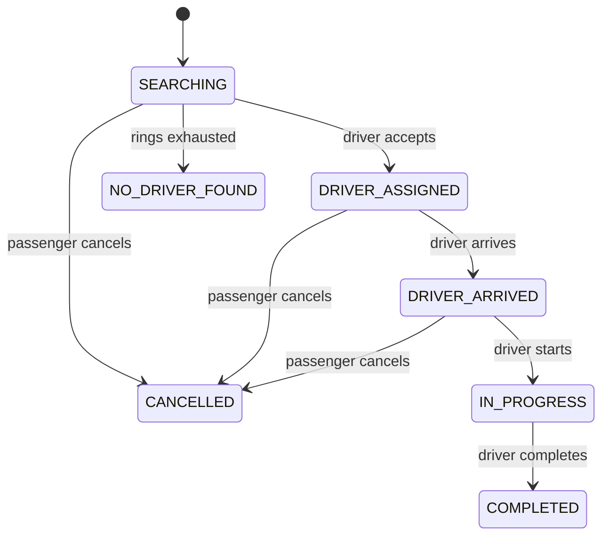

# 09 · Ride lifecycle

> Previous: [08 Offers](08-offer-acceptance-rejection-and-timeouts.md) · Next: [10 Fare](10-fare-calculation.md)

## The basic idea

A ride moves through a fixed set of **states**. A **state machine** is the list of states plus the allowed moves between them. Writing it down explicitly prevents nonsense such as "completed before it started" or "a passenger completing their own trip".

## The states

| Status | Meaning | Terminal? |
| --- | --- | --- |
| `SEARCHING` | request recorded, looking for a driver (not yet a confirmed booking) | no |
| `DRIVER_ASSIGNED` | a driver accepted and is heading to pickup | no |
| `DRIVER_ARRIVED` | driver is at the pickup | no |
| `IN_PROGRESS` | passenger on board | no |
| `COMPLETED` | trip finished, final fare recorded | yes |
| `CANCELLED` | cancelled before the trip started | yes |
| `NO_DRIVER_FOUND` | nobody within the max radius accepted | yes |



Defined in `server/src/services/rideStateMachine.js` (`TRANSITIONS`, `canTransition`). Everything not in that table is forbidden, for example `SEARCHING → IN_PROGRESS`, `IN_PROGRESS → CANCELLED`, `COMPLETED → anything`.

## Who may trigger each transition

| Transition | Endpoint | Allowed actor | Code |
| --- | --- | --- | --- |
| → `SEARCHING` | `POST /api/rides` | passenger | `rideService.createRide` |
| `SEARCHING → DRIVER_ASSIGNED` | `POST /api/offers/:id/accept` | the offered driver | `offerService.acceptOffer` |
| `SEARCHING → NO_DRIVER_FOUND` | none (system) | matching service | `matchingService.markNoDriverFound` |
| `DRIVER_ASSIGNED → DRIVER_ARRIVED` | `POST /api/rides/:id/arrive` | assigned driver | `rideService.driverTransition('arrive')` |
| `DRIVER_ARRIVED → IN_PROGRESS` | `POST /api/rides/:id/start` `{ otp }` | assigned driver, with the passenger's pickup code | `driverTransition('start')` |
| `IN_PROGRESS → COMPLETED` | `POST /api/rides/:id/complete` | assigned driver | `driverTransition('complete')` |
| `* → CANCELLED` | `POST /api/rides/:id/cancel` (passenger) or `POST /api/admin/rides/:id/cancel` (admin, `rides:manage`, audited) | owning passenger or admin | `rideService.cancelRide` |

Passengers are blocked from driver endpoints by `requireRole(DRIVER)` (`403`, test #64). Other drivers are blocked by `ride.driverId` checks (`403`, test #63).

## How a transition is applied

`rideService.driverTransition` (simplified):

```js
const step = DRIVER_STEPS[stepName];               // e.g. { from: 'DRIVER_ARRIVED', to: 'IN_PROGRESS' }
if (String(ride.driverId) !== driverUserId) throw forbidden(...);
if (ride.status === step.to && stepName !== 'start') return { ride, alreadyDone: true }; // safe repeat
if (ride.status !== step.from) throw conflict(`Cannot ${stepName} a ride that is ${ride.status}`, 'INVALID_TRANSITION');

withTransactionOrAbort(async (session) => {
  const updated = await Ride.findOneAndUpdate(
    { _id: rideId, driverId: me, status: step.from },   // conditional: still in the expected state
    { $set: { status: step.to, [step.at]: now, ... } }, { new: true, session });
  ...
  await RideEvent.create([{ eventType: step.event, previousStatus: step.from, newStatus: step.to, actorId: me }], { session });
});
```

The status in the filter means two simultaneous "start" requests can't both succeed (test #65).

### Completion does more

Inside the same transaction:

1. Compute `finalFare` from trusted data (`fareService.calculateFinalFare`, see [10](10-fare-calculation.md)).
2. Set `active: false` (the passenger may book again).
3. Release the driver: `ON_TRIP → AVAILABLE` (`releaseTripDriver`, test #72).
4. Create a `Payment` with status `PENDING`. Completion **does not** mean paid (test #94).

## Cancellation

`rideService.cancelRide`, allowed from `SEARCHING`, `DRIVER_ASSIGNED`, `DRIVER_ARRIVED` (`PASSENGER_CANCELLABLE`). In one transaction:

1. Ride → `CANCELLED`, `active: false`, `cancelledAt`, `cancelledBy`, `cancelReason`.
2. Any `PENDING` offer → `CANCELLED` and that driver's reservation released.
3. An assigned driver → `AVAILABLE`.
4. Safety net: any profile still pointing at this ride is freed.
5. Event `RIDE_CANCELLED` with `previousStatus`.

After commit: `ride:cancelled` to passenger/driver, `driver:offer-expired` (`reason: 'cancelled'`) to a driver with an open offer. Repeated cancel → `alreadyCancelled: true`. Cancelling `IN_PROGRESS` or later → `409 INVALID_TRANSITION` (test #69). There is no cancellation fee and no driver-initiated cancel in this version.

## Reservation release rules (summary)

| Event | Driver before | Driver after |
| --- | --- | --- |
| offer rejected/expired/cancelled | `RESERVED` (this ride) | `AVAILABLE` |
| offer accepted | `RESERVED` | `ON_TRIP` |
| ride cancelled after assignment | `ON_TRIP` | `AVAILABLE` |
| trip completed | `ON_TRIP` | `AVAILABLE` |

## Event history

Every transition writes a `RideEvent` in the **same transaction** as the change (test #70 checks the full sequence: `RIDE_REQUESTED, OFFER_SENT, DRIVER_ASSIGNED, DRIVER_ARRIVED, TRIP_STARTED, TRIP_COMPLETED`). Read it with `GET /api/rides/:id/events` or in the admin inspector.

## Error responses

| Situation | HTTP | `error.code` |
| --- | --- | --- |
| Wrong state (e.g. start before arrive, start twice) | 409 | `INVALID_TRANSITION` |
| Not the assigned driver | 403 | `FORBIDDEN` |
| Passenger calling a driver endpoint | 403 | `FORBIDDEN` |
| Not your ride (passenger) | 404 | `NOT_FOUND` |
| Malformed id | 400 | `BAD_REQUEST` |

## Glossary

- **State machine**: states + allowed transitions.
- **Terminal state**: no further transitions possible.
- **Transition**: a move from one state to another.
- **Audit trail**: an append-only record of what happened.

## Upgrade: codes at start and completion

- `start` and `complete` require `{ "otp": "123456" }`: the passenger's pickup and drop-off codes. The code is consumed in the same transaction as the status change, and wrong attempts are counted ([16](16-otp-and-trip-verification.md)).
- Starting the trip reveals the destination to the driver and creates the drop-off code.
- Cancelling invalidates any active codes.
- A completed ride can be rated by both sides ([17](17-reviews-and-ratings.md)); chat becomes read-only ([22](22-chat-system.md)); the safety button is available in `DRIVER_ASSIGNED`, `DRIVER_ARRIVED` and `IN_PROGRESS` ([19](19-safety-and-emergency-response.md)).
