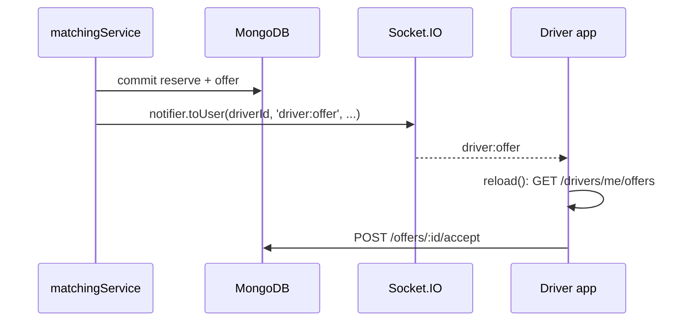
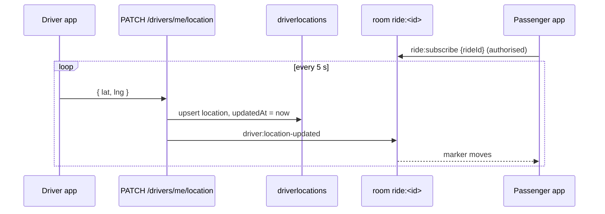

# 11 · Real-time communication and tracking

> Previous: [10 Fare](10-fare-calculation.md) · Next: [12 Docker](12-docker-local-development.md)

## The basic idea

Normal web traffic is **request–response** (HTTP): the browser asks, the server answers. The server can't speak first. That's a problem when the *server* learns something new ("a driver accepted!").

Options:

- **Polling**: the browser asks "anything new?" every few seconds. Simple, but wasteful and slow to notice changes.
- **WebSockets**: a connection that stays open so **either side can send messages at any time**. Instant and efficient.

**Socket.IO** is a library on top of WebSockets that adds automatic reconnection, fallbacks, named events and **rooms** (groups of connections you can send to).

We use both: Socket.IO for speed, and occasional polling plus re-fetching for reliability.

## Authenticated connections

The browser connects with its JWT (`client/src/services/socket.js`):

```js
socket = io({ path: '/socket.io', auth: { token }, transports: ['websocket', 'polling'] });
```

The server checks it before accepting the connection (`server/src/sockets/index.js`):

```js
io.use(async (socket, next) => {
  const payload = verifyToken(socket.handshake.auth.token);   // throws on bad token
  const user = await User.findById(payload.sub).select('role name').lean();
  if (!user) return next(new Error('UNAUTHORIZED'));
  socket.data.user = { id: String(user._id), role: user.role };
  next();
});
```

## Rooms and authorization

- On connect, each socket joins **only** `user:<its own id>`. The client cannot choose this room.
- To get live driver locations for a ride, the client emits `ride:subscribe { rideId }`. The server joins it to `ride:<rideId>` **only if** the user is that ride's passenger, assigned driver, or an admin; otherwise the acknowledgement is `{ ok: false, error: 'FORBIDDEN' }` (test #82).
- The server decides recipients; clients never send events to other clients.

## Events

Server → client (sent via `server/src/sockets/notifier.js`):

| Event | Room | Payload | When |
| --- | --- | --- | --- |
| `ride:searching` | passenger | `{ rideId, status, radiusKm }` | ride created; each radius expansion |
| `driver:offer` | that driver | `{ offerId, rideId, expiresAt, distanceToPickupMeters, pickup, destinationHidden: true, tripDistanceMeters, estimatedFare, currency, vehicleType, passengerCount, passengerName }` (no destination) | offer created |
| `driver:offer-expired` | that driver | `{ offerId, rideId, reason? }` | offer expired or ride cancelled |
| `ride:driver-assigned` | passenger + driver | `{ rideId, status, driverId }` | accept committed |
| `ride:driver-arrived` | passenger + driver | `{ rideId, status }` | |
| `ride:started` | passenger + driver | `{ rideId, status }` | |
| `ride:completed` | passenger + driver | `{ rideId, status, finalFare }` | |
| `ride:cancelled` | passenger + driver | `{ rideId, status, reason }` | |
| `ride:no-driver-found` | passenger | `{ rideId, status }` | |
| `driver:location-updated` | `ride:<id>` | `{ rideId, driverId, lat, lng, heading, updatedAt }` | driver location accepted while attached |
| `payment:updated` | passenger | `{ rideId, status }` | payment settled |

Client → server: `ride:subscribe { rideId }` (with acknowledgement), `ride:unsubscribe { rideId }`. Nothing else is handled; other emitted events are ignored (test #86).

## Sequence: a driver offer



## Sequence: live tracking



The driver app sends its position every 5 s (`client/src/hooks/useLocationReporter.js`), from GPS or from a point tapped on the map. Passing positions through `toLatLng()` means invalid coordinates are never drawn (test #89).

## Location freshness

The server stores `updatedAt` on every accepted update. Matching ignores drivers silent for longer than `LOCATION_FRESHNESS_MS` (30 s). A client may send `recordedAt`; if it's older than 30 s or in the future, the update is rejected. The passenger view marks the driver location `fresh: false` if it's more than four freshness windows old, and the UI says it's out of date.

## The database is authoritative

Events can be lost, duplicated, delayed or forged. So the passenger page (`client/src/hooks/useRideTracking.js`) **never trusts an event's content for status**; each status event triggers `GET /api/rides/:id`:

- Bursts of duplicate events collapse into one fetch at a time (test #86).
- A `ride:driver-assigned` event while the server still says `SEARCHING` shows nothing new (test #88).
- `RideStatus.jsx` shows the driver card only when the **ride status** says a driver is attached.

## Reconnection

Socket.IO reconnects automatically. On every `connect` the hook re-subscribes to the ride room **and re-fetches the ride**, so anything missed while offline is picked up (test #85). There's also a 15 s poll while a ride is active, and the driver page polls every 8 s while online.

## Multiple server processes (no Redis)

The recovery worker is a separate process with no Socket.IO server, but it creates offers and must notify drivers. We use:

- `@socket.io/mongo-adapter` in the API (`createSocketServer`): events are written to the capped collection `socket_io_events` and read back by all API processes through a change stream.
- `@socket.io/mongo-emitter` in the worker (`createMongoEmitter`): writes events into that collection.

Set by `SOCKET_ADAPTER=mongo` (default). Tested in `tests/e2e/booking-flow.test.js` ("events emitted by another process").

## Polling vs WebSockets

| | Polling | WebSockets |
| --- | --- | --- |
| Latency | up to the poll interval | immediate |
| Server load | a request per client per interval | one open connection |
| Reliability | simple; works everywhere | needs reconnection handling |
| Here | safety net | primary channel |

## What can go wrong

| Symptom | Check |
| --- | --- |
| No events at all | browser console for `UNAUTHORIZED`; token expired → sign in again |
| Driver location not moving | driver online? `docker compose logs backend | grep location`; admin Drivers tab "stale" |
| Worker-created offers not reaching driver | `SOCKET_ADAPTER=mongo` on both; collection `socket_io_events` exists |
| `ride:subscribe` returns FORBIDDEN | not your ride |

## Glossary

- **WebSocket**: a long-lived two-way connection.
- **Socket.IO event**: a named message, e.g. `driver:offer`.
- **Room**: a named group of connections; sending to a room reaches all members.
- **Acknowledgement (ack)**: a reply callback for an emitted event.
- **Polling**: repeatedly asking for updates.
- **Capped collection**: a fixed-size MongoDB collection that discards the oldest documents.

## Upgrade: new events

| Event | To | Payload |
| --- | --- | --- |
| `ride:otp-available` | passenger | `{ rideId, purpose, expiresAt }` (no code) |
| `ride:no-driver-found` | passenger | now includes `reason` |
| `chat:message` | both participants | stored message ([22](22-chat-system.md)) |
| `chat:send`, `chat:history` | client → server, with ack | see [22](22-chat-system.md) |
| `safety:incident`, `safety:dispatch-failed` | room `role:ADMIN` | incident id ([19](19-safety-and-emergency-response.md)) |
| `safety:updated` | reporter | status / dispatch status |
| `payment:updated` | passenger | unchanged |
| `chat:report` | room `role:ADMIN` | report id |
| `account:suspended` | the suspended user | the app signs out |

Admin sockets join `role:ADMIN` automatically. Socket rooms never grant access by themselves: chat checks the database on every message.
