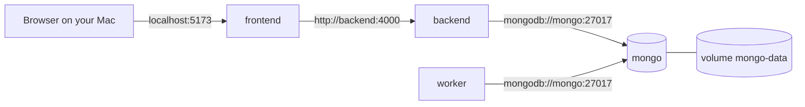

# 12 · Docker local development

> Previous: [11 Real-time](11-realtime-communication-and-tracking.md) · Next: [13 Security](13-security.md)

## The basic idea

Running this project needs Node.js, MongoDB configured as a replica set, and two Node processes plus a web server. Installing all that by hand differs per computer and breaks easily. **Docker** packages each piece with everything it needs.

- An **image** is a frozen recipe plus files (like a cake mould). Built from a `Dockerfile`.
- A **container** is a running instance of an image (a cake). You can stop, delete and recreate containers; the image stays.
- **Docker Compose** starts several containers together from one file, `docker-compose.yml`, and connects them on a private network.
- A **volume** is storage that outlives containers. Our database files live in the volume `mongo-data`.

## The services

| Service | Image / build | Port on your machine | Purpose |
| --- | --- | --- | --- |
| `mongo` | `mongo:7.0` | 27017 | MongoDB, replica set `rs0`, data in volume `mongo-data` |
| `backend` | `server/Dockerfile` target `dev` | 4000 | Express API + Socket.IO (`npm run dev`, restarts on code change) |
| `worker` | same image | none | recovery worker (`npm run worker:dev`) |
| `frontend` | `client/Dockerfile` target `dev` | 5173 | Vite dev server with hot reload; proxies `/api` and `/socket.io` to `backend` |



Socket.IO runs inside `backend`; no extra container. There is no Redis or Celery.

## `localhost` means different things in different places

This is the most common source of confusion:

- On **your machine**, `localhost:4000` reaches the backend because Compose **publishes** port 4000 to your machine (`ports: "4000:4000"`).
- **Inside a container**, `localhost` means **that container itself**. Inside `backend`, `mongodb://localhost:27017` looks for MongoDB *inside the backend container*, where there is none → connection refused.
- Containers reach each other by **service name** on the Compose network. So the backend uses `MONGO_URI=mongodb://mongo:27017/uber?replicaSet=rs0`, and Vite proxies to `http://backend:4000`.

The browser runs on your machine, not in a container, so it uses `localhost:5173`. Vite (inside the frontend container) forwards to `backend:4000`.

## MongoDB replica set initialisation

Transactions need a replica set ([07](07-concurrency-consistency-and-atomic-operations.md)). The `mongo` service starts with `--replSet rs0`, and its **health check** runs `mongo/init-replica-set.js`:

```js
try {
  const status = rs.status();                 // already initialised?
  if (status.myState !== 1) quit(1);          // not PRIMARY yet → unhealthy
  quit(0);                                    // PRIMARY → healthy
} catch (err) {
  if (err.codeName === 'NotYetInitialized') {
    rs.initiate({ _id: 'rs0', members: [{ _id: 0, host: 'mongo:27017' }] });
    quit(1);                                  // healthy on a later check
  }
}
```

- First start (empty volume): it initiates the replica set.
- Every later start: `rs.status()` works, so it does nothing. It is **repeatable** and safe on restarts.
- `backend` and `worker` use `depends_on: mongo: condition: service_healthy`, so they start only after MongoDB is PRIMARY.

The member host is `mongo:27017`. When connecting from your Mac (tests, Compass), add `directConnection=true`: `mongodb://localhost:27017/uber?directConnection=true`. Otherwise the driver would try to reach the hostname `mongo`, which your Mac doesn't know.

## Environment variables and secrets

1. `cp .env.example .env`, then put real values for `JWT_SECRET` and `PAYMENT_WEBHOOK_SECRET` (generate with `node -e "console.log(require('crypto').randomBytes(48).toString('hex'))"`).
2. `.env` is git-ignored. `.env.example` contains placeholders only.
3. Compose loads `.env` into `backend` and `worker` (`env_file`, optional). Values in `docker-compose.yml`'s `environment:` (like `MONGO_URI`) take precedence.
4. With no `.env`, development uses clearly-named insecure fallbacks; `NODE_ENV=production` refuses to start without real secrets.

## Commands

Run from the repository root.

```bash
docker compose up --build -d          # build images and start everything in the background
docker compose ps                     # status + health of each service
docker compose logs -f                # follow all logs (Ctrl+C stops following, not the app)
docker compose logs -f backend        # one service
docker compose logs -f frontend
docker compose logs -f worker
docker compose restart backend        # restart one service
docker compose up -d --build backend  # rebuild after changing server/package.json
docker compose down                   # stop and remove containers (DATA IS KEPT)
```

Open http://localhost:5173. API health: http://localhost:4000/api/health.

**Code changes:** `server/src` and `client/src` are mounted into the containers. Backend files restart the server automatically (`node --watch`); frontend files hot-reload. Rebuild only when you change `package.json` / dependencies or a Dockerfile.

### Create an admin and demo drivers

```bash
docker compose exec -e ADMIN_EMAIL=admin@example.com -e ADMIN_PASSWORD='ChooseAStrongOne1' backend npm run seed:admin
docker compose exec backend npm run simulate:drivers    # leave running; Ctrl+C to stop
```

(You can also put `ADMIN_EMAIL` / `ADMIN_PASSWORD` in `.env` and run `npm run seed:admin` without `-e`.)

### Run tests inside Docker

```bash
docker compose exec -e MONGO_URI_TEST="mongodb://mongo:27017/?replicaSet=rs0" backend npm test
docker compose exec frontend npm test
```

Tests use their own databases (`uber_test_<n>`), never `uber`. One repository-level test (checking `.gitignore`) is **skipped** inside the container because the container has no git checkout; it runs when you test on your machine.

### Reset local data (destructive)

```bash
docker compose down -v
```

`-v` **deletes the named volume `mongo-data`, which permanently removes all local database data** (users, rides, everything). Nothing in this project runs it automatically. Next `docker compose up` starts with an empty database and re-initialises the replica set.

## Health checks and shutdown

- `mongo`: replica-set script (above).
- `backend`: `wget http://127.0.0.1:4000/api/health` (returns `503` if the database is unreachable).
- `frontend`: `wget http://127.0.0.1:5173/`.

Why `127.0.0.1` and not `localhost`? Inside these Alpine containers `localhost` resolves to the IPv6 address `::1` first, but the Vite dev server listens on IPv4 only, so a `localhost` health check fails ("Connection refused") even though the app works.
- On `docker compose stop/down/restart`, containers get `SIGTERM`. `server.js` and `workers/index.js` close connections, stop the worker, clear timers and disconnect from MongoDB before exiting; `stop_grace_period` gives them time. You'll see `shutting down gracefully` / `worker shutting down` in the logs.

## Production images

`server/Dockerfile` target `prod` installs only production dependencies and runs as the unprivileged `node` user. `client/Dockerfile` target `prod` builds static files and serves them with nginx (`client/nginx.conf`) proxying `/api` and `/socket.io`. These targets are provided but not part of the default Compose setup, and were not deployed as part of this work.

## Common errors

| Error | Cause | Fix |
| --- | --- | --- |
| `ECONNREFUSED 127.0.0.1:27017` in backend logs | `MONGO_URI` uses `localhost` inside a container | use `mongo` as host |
| `Transaction numbers are only allowed on a replica set member` | MongoDB running standalone | use the Compose `mongo` service (has `--replSet`) |
| `getaddrinfo ENOTFOUND mongo` when running tests on your Mac | connecting to the member hostname | add `directConnection=true` |
| `backend` stuck "waiting" | mongo not healthy yet | `docker compose logs mongo` |
| Port already in use | something else on 4000/5173/27017 | stop it, or change the left side of `ports:` |
| `Invalid configuration: JWT_SECRET ...` | secret too short | use 16+ chars (32+ in production) or leave as `change-me` in development |
| `frontend` shows `(unhealthy)` but the app works | health check used `localhost` (IPv6 `::1`) | use `127.0.0.1` in the check (already done here) |
| Frontend shows "Cannot reach the server" | backend down | `docker compose ps`, `docker compose logs backend` |

## Glossary

- **Image / container / volume**: recipe / running instance / persistent storage.
- **Service (Compose)**: a named container definition in `docker-compose.yml`.
- **Port publishing**: making a container port reachable from your machine.
- **Health check**: a command Docker runs to decide whether a container is working.
- **Bind mount**: a folder on your machine shown inside a container (used for live code reload).

## Upgrade: new volume, variables and commands

- **New named volume `driver-documents`** (mounted at `/app/private-uploads` in `backend` and `worker`, `DOCUMENT_STORAGE_DIR`) holds encrypted driver documents. Like `mongo-data`, `docker compose down -v` **deletes it**.
- New variables are listed in `.env.example` (placeholders only): `OTP_SECRET`, `TRIP_OTP_ENCRYPTION_KEY`, `DOCUMENT_ENCRYPTION_KEY`, `SMS_PROVIDER` and `TWILIO_*`, `GOOGLE_CLIENT_ID`, `EMERGENCY_*`, chat/review settings, `VEHICLE_CATALOG_JSON`. Without them, development uses clearly-named insecure fallback keys and the dev SMS outbox; production refuses to start without real keys.
- **Migrations** run automatically when the backend or worker starts (`docker compose logs backend | grep migration`).
- After pulling dependency changes: `docker compose up -d --build backend worker frontend`.

```bash
docker compose exec backend npm run dev:outbox                  # read dev SMS codes (nothing is really sent)
docker compose exec backend npm run dev:outbox -- +919876543210  # for one number
docker compose exec backend npm run simulate:drivers            # demo drivers (also reads trip codes as the simulated passenger)
```

Provider set-up guides: Google ([24](24-authentication-providers.md#setting-up-google-needs-your-own-google-cloud-project)), SMS ([24](24-authentication-providers.md)), emergency integration ([19](19-safety-and-emergency-response.md)), document storage ([23](23-driver-document-verification.md)), maps (OpenStreetMap tiles and Nominatim search need no key), payments (mock only, [10](10-fare-calculation.md)).
