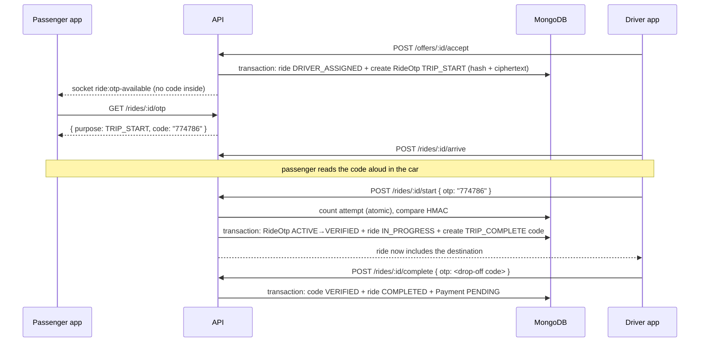

# 16 · OTP and trip verification

> Related: [09 Ride lifecycle](09-ride-lifecycle.md) · [07 Concurrency](07-concurrency-consistency-and-atomic-operations.md) · [24 Authentication providers](24-authentication-providers.md) (login OTPs)

## 1. What this feature means

An **OTP** (one-time password) is a short code, here 6 digits, that works once and only for a short time.

This app uses two separate trip codes:

| Code | When it is created | Who sees it | Who types it | What it unlocks |
| --- | --- | --- | --- | --- |
| **Pickup code** (`TRIP_START`) | when a driver accepts the ride | only the passenger | the driver, at pickup | starting the trip, and showing the destination to the driver |
| **Drop-off code** (`TRIP_COMPLETE`) | when the trip starts | only the passenger | the driver, at the destination | completing the trip |

## 2. Why it is needed

- **Right passenger, right car.** The driver can only start the trip if the person in the car knows the code, so a driver cannot start a trip without the passenger, and a passenger can check they are in the right car.
- **Destination privacy.** Drivers sometimes reject rides because of where they go, and a full address is personal information. The driver sees the destination only after the passenger is in the car and has given the pickup code.
- **Honest completion.** A trip can't be marked complete (and charged) unless the passenger confirms arrival with the second code.

## 3. How it works, step by step



1. **Issue.** `offerService.acceptOffer` calls `rideOtpService.issue(ride, 'TRIP_START', { session })` inside the same transaction that assigns the driver, so there is never an assigned ride without a code.
2. **Notify.** After the transaction commits, `rideOtpService.deliver()` sends the passenger the socket event `ride:otp-available` (without the code). If the passenger has a phone number and SMS is configured, the code is also sent by SMS (in development it goes to the dev outbox; see [24](24-authentication-providers.md)).
3. **Show.** The passenger's app calls `GET /api/rides/:rideId/otp` (passenger only; response has `Cache-Control: no-store`). `TripCodeCard.jsx` shows it in large digits.
4. **Verify.** The driver types the code (`OtpEntry.jsx`) and the app calls `POST /api/rides/:rideId/start` with `{ "otp": "123456" }`.
5. `rideService.driverTransition` first checks the ride is `DRIVER_ARRIVED` and the caller is its driver, then calls `rideOtpService.checkCode()`. That function:
   - counts the attempt **atomically before comparing** (`findOneAndUpdate` with `$inc: { attempts: 1 }` and the condition `attempts < maxAttempts`), so parallel guesses can't exceed the limit;
   - compares the HMAC in constant time;
   - on a wrong code returns `400 INVALID_OTP` with `attemptsRemaining` and records an `OTP_FAILED` ride event; after the last allowed attempt the code becomes `LOCKED`.
6. **Consume + start, together.** In one transaction: `rideOtpService.consume()` flips the code `ACTIVE → VERIFIED` (conditional: only one request can do this), the ride goes `DRIVER_ARRIVED → IN_PROGRESS` with `startedAt` and `startVerifiedAt`, and the drop-off code is issued.
7. **Destination revealed.** `rideView.buildRideView` sets `destination: null, destinationHidden: true` for a driver until `ride.startedAt` exists. After the start, the driver's view includes the destination.
8. **Completion** repeats steps 4–6 with the drop-off code on `POST /api/rides/:rideId/complete`. Completion creates a **`PENDING`** payment: verifying the code does **not** mean the passenger has paid ([10](10-fare-calculation.md)).

## 4. Files and functions

| File | What it does |
| --- | --- |
| `server/src/services/rideOtpService.js` | `issue`, `deliver`, `revealForPassenger`, `checkCode`, `consume`, `invalidateAll`, `purposeFor` |
| `server/src/models/RideOtp.js` | the stored code (hash + ciphertext, status, attempts, expiry) |
| `server/src/utils/otpCrypto.js` | `generateNumericCode` (crypto.randomInt), `hmacCode`, `safeEqualHex`, `encryptString` / `decryptString` (AES-256-GCM) |
| `server/src/services/rideService.js` | `driverTransition` (verifies and consumes inside the transition), `cancelRide` (invalidates codes) |
| `server/src/services/offerService.js` | issues the pickup code when a driver is assigned |
| `server/src/services/rideView.js` | hides the destination from drivers until the trip starts |
| `client/src/components/TripCodeCard.jsx` | passenger view of the code |
| `client/src/components/OtpEntry.jsx`, `client/src/pages/DriverHome.jsx` | driver code entry |

### How the code is stored (never in plain text)

```js
// rideOtpService.issue
codeHash: codeHash(ride._id, purpose, ride.passengerId, code),        // HMAC-SHA256 with OTP_SECRET
codeCiphertext: encryptString(config.otp.tripEncryptionKey, code),    // AES-256-GCM
```

- The **hash** is used to check what the driver typed. The hash includes the ride id, purpose and passenger id, so a code is bound to one ride and one passenger, and the same digits for a different ride or purpose do not match.
- The **ciphertext** lets the passenger see the code again after reloading the app. Only `revealForPassenger` decrypts it, and only for that ride's passenger. Both fields have `select: false`, so ordinary queries never load them.

## 5. MongoDB collections

- `rideotps`: one document per issued code. A partial unique index `one_active_otp_per_ride_purpose` allows only one `ACTIVE` code per ride and purpose.
- `rides`: `startVerifiedAt`, `completionVerifiedAt`, `startedAt`.
- `rideevents`: `OTP_FAILED` for wrong attempts; `TRIP_STARTED` / `TRIP_COMPLETED` include `otpVerified`.
- `devoutboxmessages`: development-only copy of SMS messages.

## 6. API endpoints and socket events

| Endpoint | Who | Notes |
| --- | --- | --- |
| `GET /api/rides/:rideId/otp` | passenger of the ride | returns `{ purpose, code, expiresAt, attemptsRemaining }`; creates a new code if the current one is missing/expired/locked (max `TRIP_OTP_MAX_REGENERATIONS`) |
| `POST /api/rides/:rideId/start` | assigned driver | body `{ "otp": "123456" }` (required) |
| `POST /api/rides/:rideId/complete` | assigned driver | body `{ "otp": "123456" }` (required) |

Socket event `ride:otp-available` → passenger only: `{ rideId, purpose, expiresAt }`; the code itself is never sent over the socket.

Configuration: `OTP_SECRET`, `TRIP_OTP_ENCRYPTION_KEY`, `TRIP_OTP_TTL_MS` (1 h), `TRIP_OTP_MAX_ATTEMPTS` (5), `TRIP_OTP_MAX_REGENERATIONS` (5).

## 7. What can go wrong, and 8. how it is handled

| Situation | Response | Why it is safe |
| --- | --- | --- |
| Wrong code | `400 INVALID_OTP` with `attemptsRemaining` | the attempt is counted before comparing |
| Too many wrong codes | `423 OTP_LOCKED` | the passenger's app shows a fresh code; regenerations are limited (`429 OTP_REGENERATION_LIMIT`) |
| Code expired | `410 OTP_EXPIRED` | the passenger's app fetches a new one |
| Code already used (replay) | `409 OTP_ALREADY_USED` or `409 INVALID_TRANSITION` | consumption is a conditional update in the same transaction as the transition |
| Five "start" taps at once | exactly one succeeds, others `409` | conditional `ACTIVE → VERIFIED` + conditional ride status |
| Start code typed at drop-off | `400 INVALID_OTP` | the hash is bound to the purpose |
| Driver not yet arrived | `409 INVALID_TRANSITION` | status check happens before the code check |
| Ride cancelled | all active codes → `SUPERSEDED` | `invalidateAll` inside the cancel transaction |
| Ride assigned before this feature was deployed (no code) | first `GET /otp` creates one | lazy issue in `revealForPassenger` |
| Repeated `complete` after success (network retry) | `200` with `alreadyDone: true`, no new payment/event | idempotent retry; a *late* code for a finished ride is not re-verified |

The code never appears in API responses for the driver, socket payloads, or logs. The logger also redacts any field named `otp`.

## 9. How to test

Automated: `server/tests/integration/tripOtp.test.js` (22 tests: hidden destination in ride view, REST offers and socket offers; correct/invalid/expired/replayed/locked codes; 5 concurrent starts; completion distinct from start; payment stays PENDING; codes never stored in plaintext, sent to drivers or logged; SMS only to the passenger; cancellation; legacy rides). Frontend: `client/src/__tests__/tripAndDriver.test.jsx`.

Manually: book a ride, let a driver (or the simulator) accept, read the pickup code on the passenger screen, enter a wrong code as the driver (see the error and remaining attempts), then the right one. The destination appears for the driver only after that.

## 10. Not implemented / needs credentials

- Real SMS delivery needs `SMS_PROVIDER=twilio` with Twilio credentials; it was **not** tested against a live Twilio account.
- No voice-call fallback for passengers without a smartphone.

## Glossary

- **OTP**: one-time password, a code that works once and expires.
- **HMAC**: a keyed fingerprint; without the key you can't produce or reverse it.
- **AES-GCM**: an encryption method that also detects tampering.
- **Replay**: re-sending a code that was already used.
- **Constant-time comparison**: comparing secrets in a way that takes the same time whether the first or last digit is wrong.
