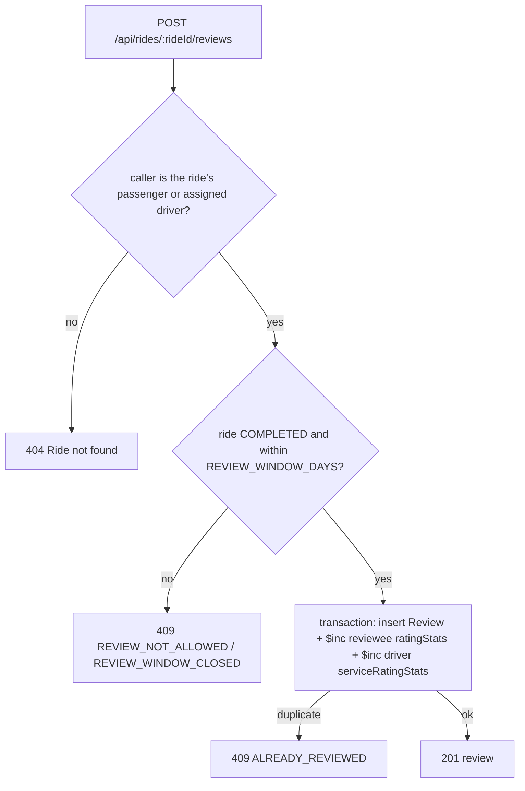

# 17 · Reviews and ratings

> Related: [02 Database](02-database-design-and-relationships.md) · [25 Admin and audit](25-admin-management-and-audit.md)

## 1. What this feature means

After a completed ride, each side can rate the other from 1 to 5 stars and add an optional comment:

- **Passenger → driver:** a driver rating, plus an optional **service rating** for the vehicle and the experience.
- **Driver → passenger:** a passenger rating.

Each person's ratings are combined into an average, for example "★ 4.7 from 120 ratings".

## 2. Why it is needed

Ratings build trust (passengers see a driver's rating when they are assigned), help operations spot problems, and give both sides a voice. Because ratings can be abused, they need strict rules and moderation.

## 3. How it works, step by step

1. The rating form (`client/src/components/ReviewForm.jsx`) appears on a completed ride if you haven't rated it yet (`GET /api/rides/:rideId/reviews/mine`).
2. `reviewService.submitReview` checks who you are on that ride. Your role decides who the review is about (`revieweeId`); it is never taken from the request.
3. The review is inserted and the reviewee's running totals (`ratingStats.sum` and `ratingStats.count`) are increased **in the same transaction**. If anything fails, neither the review nor the totals change.
4. The average is computed when displayed: `average = sum / count`, rounded to one decimal (`User.toJSON`, `rideView.ratingOf`).

## 4. Files and functions

| File | Contents |
| --- | --- |
| `server/src/services/reviewService.js` | `submitReview`, `myReviewForRide`, `receivedReviews`, `givenReviews`, `adminList`, `moderate`, `applyStats` |
| `server/src/models/Review.js` | schema and indexes |
| `server/src/controllers/reviewController.js` | HTTP handlers |
| `client/src/components/ReviewForm.jsx` | star form |
| `client/src/pages/AccountPage.jsx` | ratings received and given |
| `client/src/pages/admin/Moderation.jsx` (`Reviews`) | moderation screen |

## 5. MongoDB collections

- `reviews`: `rideId`, `reviewerId`, `revieweeId`, `reviewerRole`, `rating` (integer 1–5), `serviceRating` (optional, passengers only), `comment` (≤ 500 characters, control characters removed), `status` (`PUBLISHED` / `HIDDEN`), `moderation { by, at, reason }`.
  - **Unique index `{ rideId, reviewerId, revieweeId }`**: one review per reviewer, per ride, per person reviewed. This is what makes duplicates impossible, even with simultaneous requests.
- `users.ratingStats { sum, count }`: ratings the user received (published only).
- `driverprofiles.serviceRatingStats { sum, count }`: vehicle/service ratings.
- `auditlogs`: moderation actions.

Why running totals instead of recomputing the average each time? Reading one number is cheap; the transaction keeps the totals exactly in step with the reviews.

## 6. API endpoints

| Endpoint | Who | Purpose |
| --- | --- | --- |
| `POST /api/rides/:rideId/reviews` | passenger or assigned driver | `{ rating, serviceRating?, comment? }` |
| `GET /api/rides/:rideId/reviews/mine` | participant | your review for this ride (or null) |
| `GET /api/reviews/received?page=` | passenger/driver | published reviews about you, **without reviewer identity**, plus your summary |
| `GET /api/reviews/given?page=` | passenger/driver | your reviews |
| `GET /api/admin/reviews?status=&maxRating=&page=&limit=` | admin with `reviews:moderate` | moderation list |
| `PATCH /api/admin/reviews/:reviewId/moderation` | admin with `reviews:moderate` | `{ status: "HIDDEN" \| "PUBLISHED", reason }`; a reason is required to hide |

## 7. What can go wrong, and 8. how it is handled

| Risk | Protection |
| --- | --- |
| Rating someone you never rode with | role and ride ownership checked; strangers get `404` |
| Rating before the trip ended | `409 REVIEW_NOT_ALLOWED` |
| Double submission / double click | unique index → `409 ALREADY_REVIEWED`; totals updated once |
| Ratings of 0, 6, 3.5, "5" | `400` (Zod: integer 1–5) |
| Drivers rating the "vehicle" | `400` |
| Abusive comment | admin hides it; it disappears from public lists and the totals are reduced in the same transaction (restoring adds it back) |
| Revealing who rated whom | received reviews omit reviewer identity |

## 9. How to test

`server/tests/integration/reviews.test.js` (17 tests): both directions, completed-only, review window, only participants, duplicates (including 5 concurrent submissions), invalid ratings, accurate averages over several rides (17/4 = 4.25 shown as 4.3), anonymity, moderation with aggregate adjustment and audit, permissions, filters/pagination. Frontend: `safetyChatReview.test.jsx` (rating form).

Manually: complete a ride, rate the driver on the ride page, then open **Account** as the driver to see the rating.

## 10. Not implemented

No editing of a submitted review, no replies, no automatic abusive-language detection (moderation is manual).
