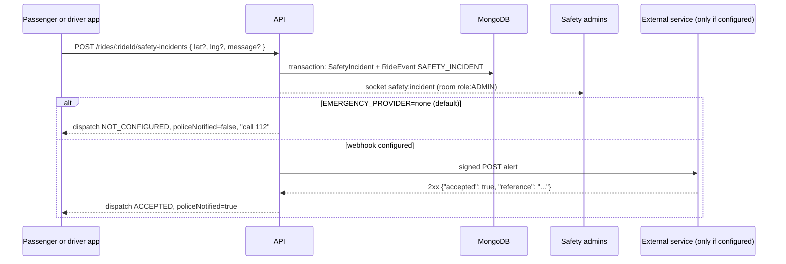

# 19 · Safety and emergency response

> Related: [11 Real-time](11-realtime-communication-and-tracking.md) · [14 Error handling](14-error-handling-and-recovery.md) · [25 Admin and audit](25-admin-management-and-audit.md)

## 1. What this feature means

During an active ride, both the passenger and the driver see a **Safety help** button. Pressing it (and confirming) creates a **safety incident**: a permanent record that this app's safety team sees immediately.

## 2. Why it is needed

People in a car with a stranger need a fast way to ask for help, and the company needs a reliable record of what happened, when and where.

### The most important rule: never pretend

Pressing a button in an app does **not** automatically reach the police. Looking up the "nearest police station" also contacts no one. So this app:

- **never** says police (or any outside service) were notified unless a configured emergency-response integration **explicitly confirmed** it accepted the alert;
- always shows the emergency number (**112** in India, `EMERGENCY_PHONE_NUMBER`) with a one-tap call link;
- tells the user exactly what happened: "Automated police dispatch is not available in this app. Our safety team has been alerted. If you are in danger, call 112 now."

## 3. How it works, step by step

1. `SafetyButton.jsx` asks for confirmation, tries to get the device location (if the user allows it), then calls the API.
2. `safetyService.report` checks you are the ride's passenger or its assigned driver, and that the ride is active (`DRIVER_ASSIGNED`, `DRIVER_ARRIVED`, `IN_PROGRESS`).
3. **Location:** the device position if sent; otherwise the driver's last known position (`DRIVER_LAST_KNOWN`); otherwise none.
4. **Context** recorded: ride status, passenger, driver, vehicle registration.
5. The incident and a `SAFETY_INCIDENT` ride event are written in one transaction.
6. **After commit:** all connected admins get `safety:incident`; a warning is logged (ids only, no message text).
7. **External dispatch** (only if configured, see below).
8. **Repeated presses** don't create new incidents: a partial unique index allows one *open* incident per ride and reporter. A repeat adds a `REPEATED_ALERT` entry to the history (and updates the location).
9. Admins **acknowledge**, **escalate** (internally, to a senior safety team) and **resolve** (note required) from the Safety tab. Every step is added to the incident history and the audit log.

## 4. The emergency integration adapter

`server/src/services/emergencyService.js`:

| `EMERGENCY_PROVIDER` | Behaviour |
| --- | --- |
| `none` (default) | nothing is sent outside the app; status `NOT_CONFIGURED` |
| `webhook` | POST JSON to `EMERGENCY_WEBHOOK_URL`, signed with HMAC-SHA256 (`X-Signature`, key `EMERGENCY_WEBHOOK_SECRET`). **Counts as delivered only if** the service answers 2xx **and** `{"accepted": true, "reference": "..."}`. Timeouts, error codes, non-JSON, or "200 OK" without `accepted: true` are failures. |

Use `webhook` only with an **authorised** emergency-response partner that accepts automated alerts.

Dispatch status (`emergencyDispatch.status`):

| Status | Meaning | `policeNotified` |
| --- | --- | --- |
| `NOT_CONFIGURED` | no integration exists | false |
| `PENDING` | trying / retrying; not confirmed | false |
| `ACCEPTED` | the external service confirmed receipt | **true** |
| `FAILED` | gave up after `EMERGENCY_MAX_ATTEMPTS` (5); admins alerted (`safety:dispatch-failed`) | false |

**Retries without Redis:** failed attempts set `nextAttemptAt` with exponential backoff (5 s, 10 s, 20 s… up to 5 min). The recovery worker's `retryEmergencyDispatches` task retries due incidents. Each attempt first **claims a lease** (`emergencyDispatch.lockedUntil`, 30 s) with a conditional update, so two workers never send the same alert twice at the same time (tested). An admin can request a retry after `FAILED`; without an integration that request is refused (`409`), never faked.

## 5. Files and MongoDB collections

- `server/src/services/safetyService.js`: `report`, `dispatchIncident`, `retryDueDispatches`, `getForUser`, `publicConfig`, `adminList`, `adminGet`, `adminAction`, `dispatchSummary`.
- `server/src/services/emergencyService.js`: adapter.
- `server/src/models/SafetyIncident.js`: collection `safetyincidents` (`status`, `active`, `location { point, source, capturedAt }`, `context`, `emergencyDispatch`, `history[]`); index `one_open_incident_per_ride_reporter`.
- `rideevents` (`SAFETY_INCIDENT`), `auditlogs` (`SAFETY_ACKNOWLEDGE`, `SAFETY_ESCALATE`, `SAFETY_RESOLVE`, `SAFETY_DISPATCH_RETRY`).
- Frontend: `client/src/components/SafetyButton.jsx`, `client/src/pages/admin/Safety.jsx`.

## 6. Endpoints and socket events

| Endpoint | Who |
| --- | --- |
| `GET /api/safety/config` | signed-in users: `{ emergencyNumber, automatedDispatchAvailable }` |
| `POST /api/rides/:rideId/safety-incidents` | passenger or assigned driver of an active ride |
| `GET /api/safety/incidents/:incidentId` | the reporter |
| `GET /api/admin/safety-incidents`, `GET /api/admin/safety-incidents/:id` | admin with `safety:manage` |
| `PATCH /api/admin/safety-incidents/:id` | `{ action: ACKNOWLEDGE \| ESCALATE \| RESOLVE \| RETRY_DISPATCH, note }` |

Sockets: `safety:incident`, `safety:dispatch-failed` → room `role:ADMIN`; `safety:updated` → reporter.

**Access:** only the reporter and permitted admins can read an incident. The *other* person on the ride cannot (they may be the reason for the alert).

## 7. What can go wrong, and 8. how it is handled

| Failure | Handling |
| --- | --- |
| The request itself fails (no network) | the app says the alert was **NOT recorded** and shows the call button |
| Integration down / slow / ambiguous answer | `PENDING` → retries → `FAILED`; never reported as accepted |
| Several workers retrying | lease: one delivery per attempt |
| Repeated presses | one incident, history grows |
| Unrelated user tries to report or read | `404` / `403` |

## 9. How to test

`server/tests/integration/safety.test.js` (15 tests) uses a **local fake emergency service** to test: an accepted alert (with signature check); error status, "200 without acceptance" and non-JSON responses (never reported as dispatched, retried, then `FAILED`); network failure; the lease with three concurrent retries; plus access control, repeated presses, admin workflow and audit. Frontend: `safetyChatReview.test.jsx` checks the UI never claims police were notified and reports failures as "NOT recorded".

## 10. Not implemented / needs an external partner

No real emergency-response integration is configured or verified. This project does not assume any public, self-service API for India's 112/ERSS exists; connecting to emergency services would require an agreement with the authorities or an authorised provider, who would supply the endpoint and the acceptance format. There is no trusted-contacts sharing or automatic ride recording.
