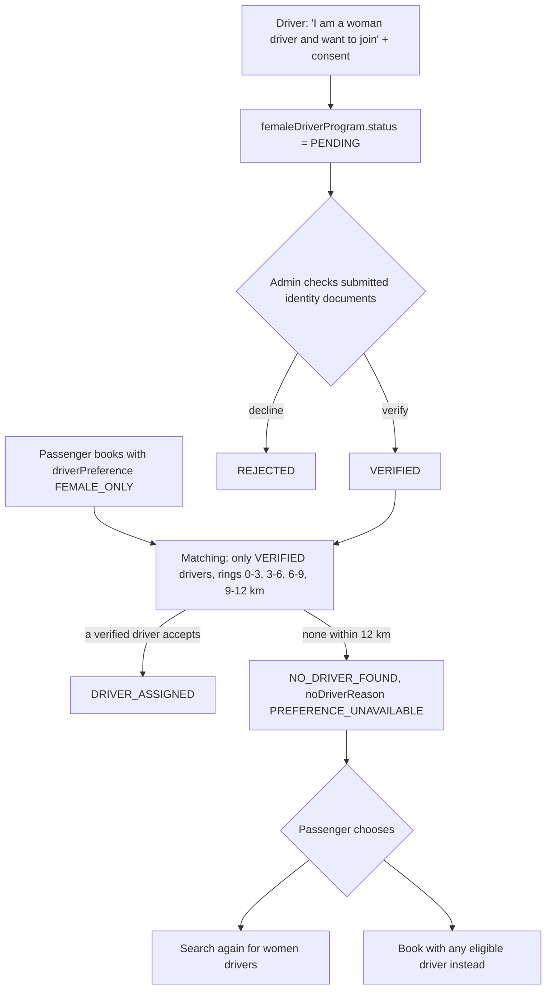

# 20 · Women's safety and matching preferences

> Related: [05 Progressive radius](05-progressive-radius-search.md) · [06 Matching](06-driver-matching-algorithm.md) · [23 Driver documents](23-driver-document-verification.md)

## 1. What this feature means

When booking, a passenger can choose:

- **Any eligible driver** (default), or
- **Women drivers only**, meaning only drivers whose eligibility an administrator has **verified**.

## 2. Why it is needed

Many women feel safer with a woman driver, especially at night. The preference has to be **real**: enforced by the server, never silently ignored, and based on verified data.

## 3. How it works, step by step

1. **Driver side.** A driver opts in from the onboarding page (`POST /api/drivers/me/female-program { action: "REQUEST", consent: true }`). An admin verifies it using the driver's submitted identity documents (`PATCH /api/admin/drivers/:driverId/female-verification`, audited). **Nothing is inferred from a name, a photo or anything else.**
2. **Passenger side.** `BookingForm.jsx` offers the choice. `POST /api/rides` stores `driverPreference: "FEMALE_ONLY"`.
3. **Matching** adds the condition `femaleDriverProgram.status === 'VERIFIED'` through `rideEligibilityFilter` (`server/src/services/driverEligibility.js`). It applies in the candidate search, the atomic reservation and the accept transaction, so a forged offer to an unverified driver can't be accepted. Progressive-radius search is unchanged: rings are still searched nearest-first and expanded when no eligible driver remains.
4. **Not available?** If no verified driver accepts within the maximum radius, the ride ends as `NO_DRIVER_FOUND` with `noDriverReason: "PREFERENCE_UNAVAILABLE"`. The app says so plainly ("We did not assign anyone else") and offers two explicit buttons: **search again for women drivers**, or **book with any eligible driver instead**. The restriction is never dropped silently.

## 4. Files

`server/src/services/driverEligibility.js`, `matchingService.js` (`markNoDriverFound` sets the reason), `driverOnboardingService.js` (`setFemaleProgramRequest`, `setFemaleVerification`), `rideView.js` (privacy), `client/src/components/BookingForm.jsx`, `RideStatus.jsx`, `pages/RidePage.jsx` (rebook buttons), `pages/DriverOnboarding.jsx`, `pages/admin/Drivers.jsx`.

## 5. MongoDB fields

- `driverprofiles.femaleDriverProgram { status: NOT_REQUESTED | PENDING | VERIFIED | REJECTED, requestedAt, reviewedAt, reviewedBy }`: the **only** gender-related data stored.
- `rides.driverPreference` (`ANY` / `FEMALE_ONLY`), `rides.noDriverReason`.
- `auditlogs`: `FEMALE_PROGRAM_VERIFIED`, `FEMALE_PROGRAM_REJECTED`, `FEMALE_PROGRAM_NOT_REQUESTED`.

## 6. Privacy policy (as implemented)

| Data | Who can see it |
| --- | --- |
| A driver's programme status | the driver themself; admins with `drivers:review` |
| A ride's `driverPreference` | the passenger and admins. **Never drivers:** it is removed from the driver's ride view, offers and socket payloads, because it can reveal something personal about the passenger |
| Gender of passengers | not collected at all; the preference is self-selected |

The feature can be turned off with `FEMALE_DRIVER_PREFERENCE_ENABLED=false` (booking with `FEMALE_ONLY` then returns `409`).

## 7. What can go wrong, and 8. how it is handled

| Risk | Handling |
| --- | --- |
| Unverified driver gets a women-only ride | filter at search, reservation and acceptance (tested with a forged offer) |
| Preference silently ignored when no match | `PREFERENCE_UNAVAILABLE`; the passenger decides |
| Two women-only rides, one verified driver | atomic reservation: one offer only (tested concurrently) |
| Driver self-certifies | only an admin can set `VERIFIED`; drivers calling the admin endpoint get `403` |
| Leaking the preference to drivers | stripped from all driver-facing payloads (tested) |

## 9. How to test

`server/tests/integration/preferences.test.js` (7 tests). A mutation check (removing the condition from the filter) made 5 of them fail, which confirms they really test the rule. Manually: approve and verify a driver in the admin console, then book with "Women drivers only".

## 10. Not implemented

No passenger-side verification (the option is available to every passenger, by choice), no "prefer but allow others" soft mode, and no automated identity check against a government database.
