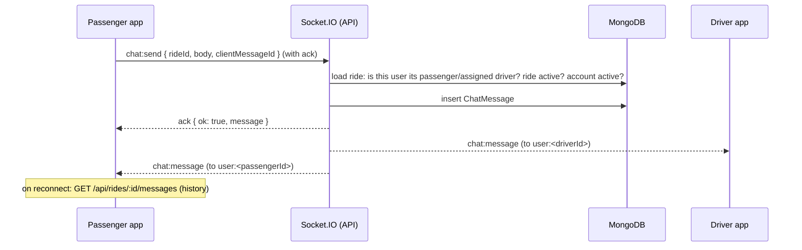

# 22 · Chat system

> Related: [11 Real-time](11-realtime-communication-and-tracking.md) · [19 Safety](19-safety-and-emergency-response.md)

## 1. What this feature means

Once a driver is assigned, the passenger and that driver can send each other short text messages ("I'm at gate 2"). Messages arrive instantly and are saved, so they are still there after a reconnect.

## 2. Why it is needed

Pickups often need a quick clarification. In-app chat avoids sharing personal phone numbers and keeps a record if something goes wrong.

## 3. How it works, step by step

1. `ChatPanel.jsx` loads the history with `GET /api/rides/:rideId/messages` (the database is the source of truth).
2. Sending uses the socket event `chat:send` when connected and `POST /api/rides/:rideId/messages` otherwise. Each message carries a random `clientMessageId`.
3. `chatService.sendMessage` checks **on every message, in the database**:
   - the sender is the ride's passenger or **assigned** driver (a driver who was only offered the ride is not a participant);
   - the ride is `DRIVER_ASSIGNED`, `DRIVER_ARRIVED` or `IN_PROGRESS`;
   - the account is still active (a suspended user's open socket can't keep chatting);
   - the text is 1–500 characters after trimming (control characters removed);
   - the user has not sent more than 10 messages in 10 seconds.
4. The message is stored **first**, then delivered to both participants' personal rooms (`user:<id>`). Joining a ride room grants nothing: authorisation is never inferred from room membership.
5. If the same `clientMessageId` arrives again (a retry after a dropped connection), the stored message is returned and no duplicate is created; a unique index enforces this.
6. The UI merges messages by id (`mergeMessages`), so the ack and the echoed event never show twice.

### After the ride

| Time | Chat |
| --- | --- |
| Driver attached | read and write |
| Ride completed or cancelled | read-only for `CHAT_READ_AFTER_RIDE_MS` (24 h), then `410` |
| `CHAT_RETENTION_DAYS` (30) after sending | deleted by the recovery worker (`purgeOldMessages`), **unless** the ride has a chat report or a safety incident (kept for review) |

### Reports and admin access

A participant can report the other person's message (`POST /api/rides/:rideId/messages/:messageId/report`). Admins with `chat:read` see reports and may read **only reported conversations or ones linked to a safety incident**; each read is recorded in the audit log (`CHAT_VIEWED`).

## 4. Files

`server/src/services/chatService.js` (`sendMessage`, `history`, `reportMessage`, `adminListReports`, `adminConversation`, `adminResolveReport`, `purgeOldMessages`), `server/src/sockets/index.js` (`chat:send`, `chat:history` handlers), `server/src/controllers/chatController.js`, `client/src/components/ChatPanel.jsx`, `client/src/pages/admin/Moderation.jsx` (`ChatReports`).

## 5. MongoDB collections

- `chatmessages`: `rideId`, `senderId`, `senderRole`, `body`, `clientMessageId`, `createdAt`. Unique `{ rideId, senderId, clientMessageId }`; index `{ rideId, createdAt }`.
- `chatreports`: `rideId`, `messageId`, `reporterId`, `reason`, `status` (`OPEN`/`REVIEWED`); unique `{ messageId, reporterId }`.

## 6. Endpoints and socket events

| | |
| --- | --- |
| `chat:send` (client → server, ack) | `{ rideId, body, clientMessageId }` → `{ ok, message, duplicate }` or `{ ok: false, error }` |
| `chat:history` (client → server, ack) | `{ rideId, before? }` → `{ ok, messages }` |
| `chat:message` (server → participants) | the stored message |
| `GET /api/rides/:rideId/messages?before=&limit=` | history |
| `POST /api/rides/:rideId/messages` | REST fallback send |
| `POST /api/rides/:rideId/messages/:messageId/report` | `{ reason }` |
| `GET /api/admin/chat-reports`, `PATCH /api/admin/chat-reports/:reportId`, `GET /api/admin/rides/:rideId/messages` | admin (`chat:read`) |

## 7. What can go wrong, and 8. how it is handled

| Problem | Handling |
| --- | --- |
| Outsider reads or sends | `404`/`NOT_FOUND` on every call (checked in DB) |
| Lost connection mid-send | retry with the same `clientMessageId` is idempotent |
| Missed messages while offline | history re-fetched on every reconnect |
| Spam | 10 messages / 10 s per user → `CHAT_RATE_LIMITED` (in-memory, per API process) |
| Long or empty messages | `400` |
| Private content in logs | message bodies are never logged (tested) |

## 9. How to test

`server/tests/integration/chat.test.js` (13 tests with real Socket.IO clients), frontend `safetyChatReview.test.jsx` (de-duplication, reconnect, rate-limit error, read-only after ride).

## 10. Not implemented

No images or voice notes, no read receipts or typing indicators, no automatic translation. The chat rate limit is per process (a shared limit across many API servers would need shared storage).
