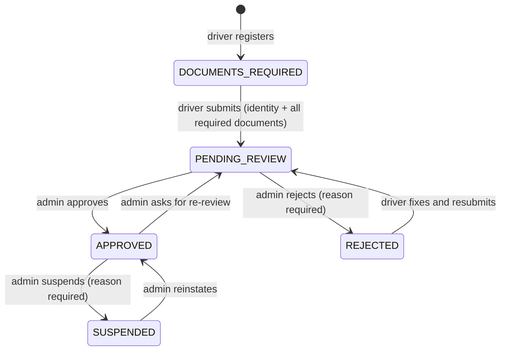

# 23 · Driver registration and document verification

> Related: [03 Auth](03-authentication-and-authorization.md) · [13 Security](13-security.md) · [25 Admin and audit](25-admin-management-and-audit.md)

## 1. What this feature means

Before someone can drive, they provide identity details and upload documents (photo, driving licence, vehicle registration certificate, Aadhaar, and optionally insurance and PAN). An administrator reviews them and approves or rejects the application. Only approved drivers can go online or receive rides.

## 2. Why it is needed

Passengers get into strangers' cars. The platform must know who its drivers are, that they are licensed, and that the vehicle is registered, and it must protect these very sensitive documents.

**What "approved" means here:** an administrator looked at the uploaded files and accepted them. **No government database (DigiLocker, UIDAI, Parivahan…) is consulted**; that would require an authorised integration this project does not have.

## 3. How it works, step by step

1. **Register** (`POST /api/auth/register`, role `DRIVER`): name, email, password, vehicle (type, registration, optional seats) and **identity** (legal name, date of birth: driver must be 18+, licence number). The profile starts as `DOCUMENTS_REQUIRED`; the app opens the onboarding page (`DriverOnboarding.jsx`).
2. **Upload** each document (`POST /api/drivers/me/documents`, multipart field `file` + `type`):
   - at most `DOCUMENT_MAX_BYTES` (5 MB), one file;
   - the **real file type is detected from its first bytes** ("magic bytes"), not the file name or browser header: only JPEG, PNG, PDF; a declared type that doesn't match the content is refused;
   - the file is **encrypted** (AES-256-GCM, `DOCUMENT_ENCRYPTION_KEY`) and written to private storage under a random name; then its metadata is saved in a transaction. If the database step fails, the file is removed;
   - uploading the same type again replaces the old document (the old one becomes `SUPERSEDED`).
3. **Submit** (`POST /api/drivers/me/submit-for-review`): allowed only when identity is complete and every type in `DRIVER_REQUIRED_DOCUMENTS` is present. Status → `PENDING_REVIEW`; uploads are now locked.
4. **Review** (admin, Drivers tab): the admin opens each document (decrypted in memory, streamed with `Cache-Control: no-store`; **every view is audited** as `DOCUMENT_VIEWED`), then:
   - **Approve**: all required documents must be present and not rejected; submitted documents become `ACCEPTED`.
   - **Reject** with a reason (shown to the driver), optionally marking specific documents for re-upload.
   - **Suspend** an approved driver with a reason (not while they hold a ride); **reinstate** later.
   The decision records `review.reviewedBy` and `review.reviewedAt` and writes an audit entry **in the same transaction**.
5. **Resubmit**: a rejected driver sees the reason and missing documents, uploads replacements and submits again.
6. **Vehicle change** (`PUT /api/drivers/me/vehicle`): the driver goes back to `DOCUMENTS_REQUIRED` and offline; RC and insurance are superseded and must be uploaded again.

### What unapproved drivers can't do

`setAvailability` refuses `AVAILABLE` unless `APPROVED` (`403`); matching and reservation only consider `APPROVED` drivers; `acceptOffer` re-checks approval. A rejected or suspended driver can't receive or accept rides (tested).

## 4. Secure storage

`server/src/services/documentStorage.js` implements a small interface, `put` / `get` / `remove`:

- files are encrypted before touching the disk; a copied disk or backup does not expose them;
- names are random 32-hex keys (nothing about the driver or document type), validated against path traversal;
- directories `0700`, files `0600`;
- the directory (`DOCUMENT_STORAGE_DIR`, the Docker volume `driver-documents` at `/app/private-uploads`) is **not served** by Express or Vite. The only way to read a file is the authenticated, permission-checked, audited endpoint. There are no public URLs (tested: guessed paths return `404`).

A cloud store (for example S3 with encryption and no public access) could implement the same three functions.

## 5. Data minimisation and retention

- **No Aadhaar or PAN numbers are ever stored**; only the uploaded image, which the app asks drivers to **mask** (hide the first 8 Aadhaar digits). Aadhaar/PAN are configurable (`DRIVER_REQUIRED_DOCUMENTS`); by default Aadhaar is required and PAN optional.
- Identity kept: legal name, date of birth, licence number (needed operationally).
- **Retention:** rejected and superseded files get `deleteAfter = now + DOCUMENT_RETENTION_DAYS` (30). The recovery worker's `purgeExpiredDocuments` deletes the file and marks `fileDeletedAt` (idempotent). Viewing a purged file returns `410`.
- Accepted documents of active drivers are kept while the driver is active; deleting the data of drivers who leave is **not yet automated**.

## 6. Files, collections, endpoints

Files: `server/src/services/driverOnboardingService.js` (`sniffMime`, `onboardingStatus`, `uploadDocument`, `updateIdentity`, `submitForReview`, `adminDecision`, `setFemaleVerification`, `adminDriverDetail`, `readDocumentForAdmin`, `purgeExpiredDocuments`), `documentStorage.js`, `auditService.js`, `middleware/upload.js` (multer, memory only), `controllers/onboardingController.js`; client `pages/DriverOnboarding.jsx`, `pages/admin/Drivers.jsx`.

Collections: `driverprofiles` (`identity`, `approvalStatus`, `review`), `driverdocuments` (`type`, `storageKey` (hidden), `mimeType`, `sizeBytes`, `sha256`, `status`, `reviewedBy/At`, `rejectionReason`, `deleteAfter`, `fileDeletedAt`; partial unique index `one_current_document_per_type`), `auditlogs`.

| Endpoint | Who |
| --- | --- |
| `GET /api/drivers/me/onboarding` | driver: status, missing documents, rejection reason |
| `GET /api/drivers/me/documents` | driver: own document metadata |
| `POST /api/drivers/me/documents` | driver (rate limited) |
| `PUT /api/drivers/me/identity` | driver (before submission / after rejection) |
| `POST /api/drivers/me/submit-for-review` | driver |
| `GET /api/admin/drivers/:driverId` | `drivers:review` |
| `PATCH /api/admin/drivers/:driverId/approval` | `drivers:review`: `{ approvalStatus, reason?, documentDecisions? }` (legacy value `PENDING` maps to `PENDING_REVIEW`) |
| `GET /api/admin/drivers/:driverId/documents/:documentId/file` | `documents:read`, audited |

## 7. What can go wrong, and 8. how it is handled

| Problem | Handling |
| --- | --- |
| Executable renamed `.png`, PDF claimed as JPEG | `415` (magic-byte check; tested, and the check was confirmed by a mutation test) |
| Huge upload | `413` before anything is stored |
| Two uploads of the same type at once | one current document remains (unique index + transaction) |
| Admin without permission | `403` |
| Approving with missing/rejected documents | `409 DOCUMENTS_INCOMPLETE`; the whole decision rolls back |
| Lost encryption key | documents become unreadable; keep `DOCUMENT_ENCRYPTION_KEY` in a secret manager and back it up |

## 9. How to test

`server/tests/integration/driverDocuments.test.js` (20 tests) uses tiny **synthetic** files with valid headers (`tests/helpers/documents.js`), never real documents. Manually: register as a driver, upload files on the Documents page, submit, then approve as admin.

## 10. Not implemented / needs external services

No automated KYC or government verification, no OCR, no expiry tracking for licences or insurance, no automated deletion when a driver leaves, no virus scanning (files are never executed or served publicly, but a scanner should be added before production).
