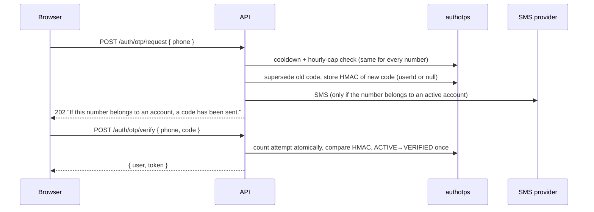

# 24 · Authentication providers

> Related: [03 Authentication and authorization](03-authentication-and-authorization.md) · [16 Trip OTPs](16-otp-and-trip-verification.md)

## 1. What this feature means

Three ways to sign in, all ending with the **same kind of session** (a JWT, see [03](03-authentication-and-authorization.md)):

1. **Email + password** (unchanged).
2. **Mobile OTP**: type your phone number, receive a 6-digit code by SMS, type it in.
3. **Google**: "Continue with Google".

## 2. Why it is needed

Many people in India prefer phone-based sign-in; others want one-tap Google sign-in. Each method has its own risks, so each needs careful rules.

## 3a. Mobile OTP: step by step

1. The phone number is normalised (`utils/phone.js`: "98765 43210" → "+919876543210"). Migration `004-normalize-phones` converted stored numbers.
2. **No account enumeration:** a challenge is recorded for **every** request, registered or not, and the response is identical. An SMS is sent only for active accounts.
3. **Limits:** one code per `LOGIN_OTP_RESEND_COOLDOWN_MS` (60 s) per number (`429 OTP_COOLDOWN`), `LOGIN_OTP_MAX_PER_HOUR` (5) per number (`429 OTP_LIMIT`), plus the IP rate limit on auth endpoints.
4. Codes expire after `LOGIN_OTP_TTL_MS` (5 min), allow `LOGIN_OTP_MAX_ATTEMPTS` (5) tries (then `LOCKED`), and are stored only as an HMAC (`OTP_SECRET`). A new request supersedes the previous code.
5. Verification counts the attempt **before** comparing, then flips `ACTIVE → VERIFIED` with a conditional update. Five parallel verifications with the right code produce exactly one session, and a used code can't be replayed.
6. Errors are always the generic `401 Invalid or expired code`. A successful login sets `phoneVerifiedAt`.

### SMS providers (`SMS_PROVIDER`)

| Value | Behaviour |
| --- | --- |
| `dev_outbox` | **Development only.** Nothing is sent. Messages are stored in `devoutboxmessages` (auto-deleted after 1 h). Read them with `docker compose exec backend npm run dev:outbox` (or `-- +91…` for one number). The API reports `delivery: "DEV_OUTBOX_NOT_SENT"` and the login page says "no SMS was sent". **Refused in production.** |
| `twilio` | Real SMS via Twilio (`TWILIO_ACCOUNT_SID`, `TWILIO_AUTH_TOKEN`, `TWILIO_FROM_NUMBER`). Implemented, **not tested against a live account**. Delivery failures are logged without the message text. |
| `disabled` | Phone sign-in returns `503 SMS_UNAVAILABLE`; the phone tab is hidden. Default in production if not set. |

## 3b. Google sign-in: step by step

1. The login page asks the server (`GET /api/auth/providers`) whether Google is configured. Only then is the Google button (Google Identity Services) shown (`GoogleSignIn.jsx`).
2. Google gives the browser an **ID token** (a signed JWT). The browser sends it to `POST /api/auth/google`.
3. `googleIdentity.verifyGoogleIdToken` (library `jose`) checks:
   - the **signature** against Google's public keys (`https://www.googleapis.com/oauth2/v3/certs`),
   - **issuer** is `https://accounts.google.com` or `accounts.google.com`,
   - **audience** is *our* `GOOGLE_CLIENT_ID` (a token issued to another app is rejected),
   - **expiry** (`exp`), algorithm RS256 only.
4. Then `authService.googleSignIn`:
   - Google account already linked (matched by Google's stable `sub`, never by email) → sign in.
   - **Email already used by another account → `409 ACCOUNT_LINK_REQUIRED`. We never merge accounts automatically**, even when the email matches, because whoever controls the Google account is not proven to be the owner of the existing account.
   - New and `email_verified` → create a **passenger** account with no password.
   - Email not verified by Google → `403`.
5. **Explicit linking:** the account owner signs in normally, opens **Account** and clicks Continue with Google → `POST /api/auth/google/link`. A Google account already linked to someone else is refused (`409 IDENTITY_IN_USE`).

## 4. Files

`server/src/services/authService.js` (`requestLoginOtp`, `verifyLoginOtp`, `googleSignIn`, `linkGoogle`, `providerStatus`), `services/smsService.js`, `services/googleIdentity.js`, `utils/otpCrypto.js`, `utils/phone.js`, `models/AuthOtp.js`, `models/DevOutboxMessage.js`, `scripts/devOutbox.js`; client `pages/AuthPages.jsx` (`PhoneLogin`), `components/GoogleSignIn.jsx`, `pages/AccountPage.jsx`.

## 5. Collections

`authotps` (phone, userId or null, codeHash, status, attempts, expiresAt; one ACTIVE per phone; TTL clean-up 24 h after expiry), `users.authProviders[] { provider, subject, email, emailVerified, linkedAt }` with unique index `unique_external_identity`, `users.phoneVerifiedAt`, `users.passwordHash` (now optional), `devoutboxmessages`.

## 6. Endpoints

| Endpoint | Notes |
| --- | --- |
| `GET /api/auth/providers` | `{ password, phoneOtp, phoneOtpDelivery, google, googleClientId }` (the client id is public by design) |
| `POST /api/auth/otp/request` | `{ phone }` → `202` |
| `POST /api/auth/otp/verify` | `{ phone, code }` → `{ user, token }` |
| `POST /api/auth/google` | `{ idToken }` → `200` existing / `201` created / `409 ACCOUNT_LINK_REQUIRED` |
| `POST /api/auth/google/link` | signed in; `{ idToken }` |
| `POST /api/auth/login`, `/register`, `GET /api/auth/me` | unchanged (suspended accounts get `403 ACCOUNT_SUSPENDED`) |

## 7. What can go wrong, and 8. how it is handled

| Attack / failure | Handling |
| --- | --- |
| Discovering which phone numbers are registered | identical responses and cooldowns for all numbers |
| Brute-forcing a code | 5 attempts per code (counted atomically), cooldown, hourly cap, IP rate limit |
| Replaying a code | single-use conditional update |
| Token for another app / forged / expired | signature, audience, issuer, expiry checks → `401` (tested with locally generated keys) |
| Account takeover by matching email | no automatic linking |
| Two first-time Google sign-ins at once | one account (unique index + re-check); a race found during testing was fixed |
| SMS provider down | logged; the generic response is unchanged |

## 9. How to test

`server/tests/integration/authProviders.test.js` (22 tests) and `auth.test.js`. Google tests sign tokens with an RS256 key generated in the test and verify them through the real `jose` code path (only the key set is swapped). Frontend: `bookingAndAuth.test.jsx` (phone flow, dev-outbox notice, hidden Google button).

### Setting up Google (needs your own Google Cloud project)

1. Google Cloud Console → APIs & Services → **OAuth consent screen** (External, add your email as a test user).
2. **Credentials → Create credentials → OAuth client ID → Web application**.
3. Authorised JavaScript origins: `http://localhost:5173` (and your production origin).
4. Put the client id in `.env` as `GOOGLE_CLIENT_ID=…apps.googleusercontent.com` and restart the backend. No client secret is needed for ID-token sign-in.

## 10. Not implemented / needs credentials

Live Google and Twilio were **not** exercised (no credentials). No sign-up by phone alone (phone login works for accounts that have that phone), no "unlink Google", no refresh tokens, no 2-step verification.
